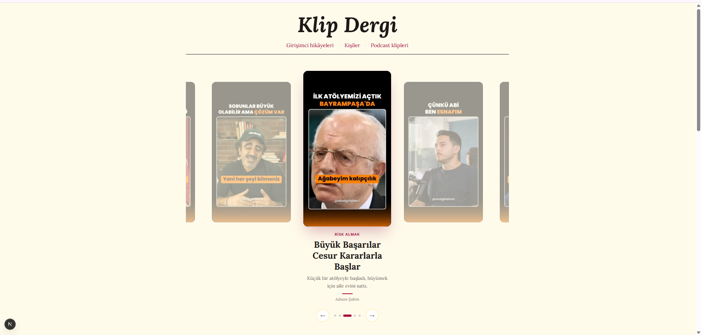
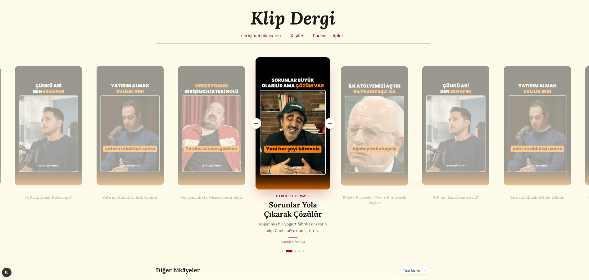
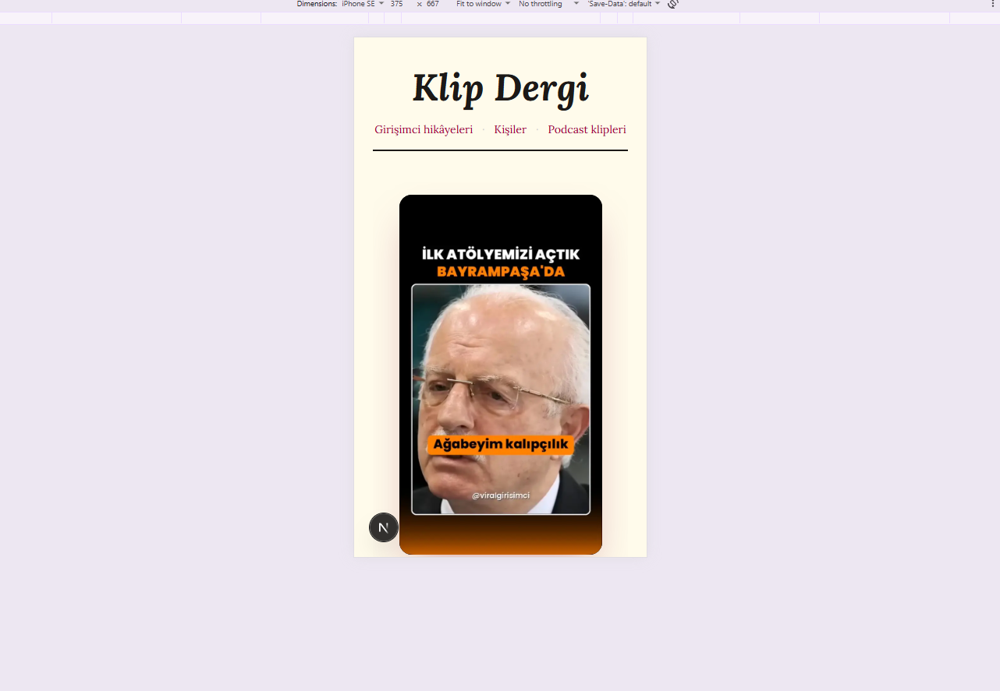
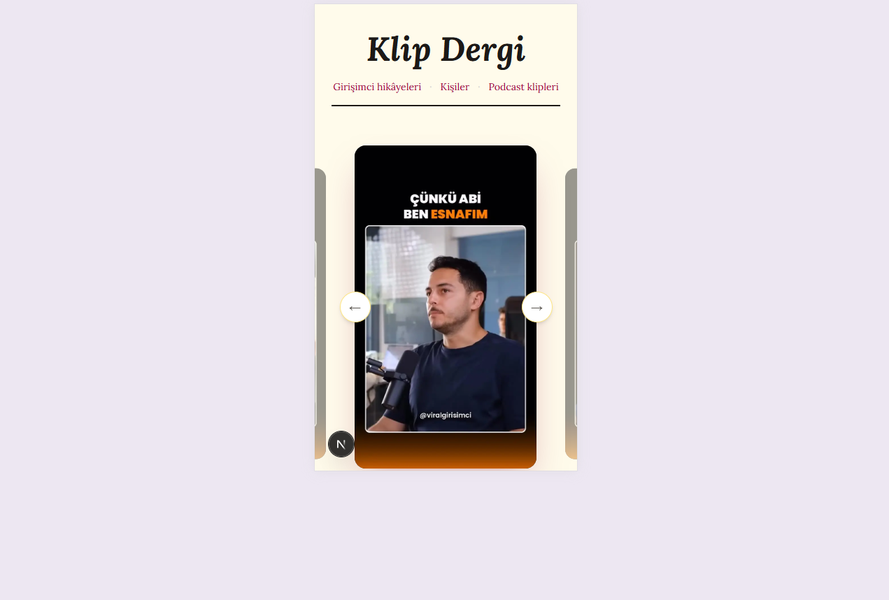

# Gün 20 · 17 Kasım Salı planı · çalıştığım gün: 17-18 Kasım

Dal: `hafta5`

## Planın istediği

- **Ana sayfa vitrini:** Dar kutudan çıksın, ekranın iki kenarına kadar uzansın.
- **Sonsuz döngü:** Sondan sonra ilk kart, ilkten önce son kart gelsin. İlk açılışta aktif kartın iki yanında kart görünsün.
- **Oklar:** Aktif kartın hemen yanında olsun, ilk açılışta görünsün.
- **Başlıklar:** Yan kartlarda küçük, gri ve soluk; aktif kartta büyüyüp canlansın.
- **Korunacaklar:** Telefonda parmakla kaydırma çalışsın; `prefers-reduced-motion` açıksa otomatik kayma dursun.
- **Çıktı:** Geniş ekran ve telefon için önce/sonra ekran görüntüleri.

📚 Kaynak: Planda Salı için ayrı kaynak yok. `prefers-reduced-motion` için MDN.

## Durum

| # | Madde | Durum | Commit |
|---|---|---|---|
| 1 | Önce ekran görüntüleri | ✅ | `44c1af4` |
| 2 | Tam genişlik | ✅ | `36179ac` |
| 3 | Sonsuz döngü | ✅ | `dd4216f` |
| 4 | Oklar aktif kartın yanında | ✅ | `2b6f1f5` |
| 5 | Yan başlıklar soluk, aktif büyük | ✅ | `89d9a45` |
| 6 | Kaydırma + hareket azaltma testi | ✅ | – (kod zaten vardı) |
| 7 | Sonra ekran görüntüleri | ✅ | `1a8a238` |
| + | Pazartesi Lighthouse görüntülerini tarihli adlandır | ✅ | `ead3a9d` |

375 px ve geniş ekran kontrolü yapıldı ✅

## Önce / sonra

| | Önce | Sonra |
|---|---|---|
| Geniş |  |  |
| Telefon |  |  |

**Önce görülen sorunlar:**
- Vitrin dar kutunun içindeydi (1152 px), ekranın iki yanı boş kalıyordu.
- İlk açılışta 1. kartın solu, son kartta sağ taraf boştu. Telefonda yanlarda hiç kart görünmüyordu.
- Oklar en alttaydı, telefonda ilk ekranda görünmüyordu.
- Yan kartların başlığı hiç görünmüyordu.

## 1. Tam genişlik (`src/app/page.tsx`)

- Sebep: `<main className="mx-auto max-w-6xl px-6 py-10">`. Başlık, vitrin ve diğer hikâyeler hepsi aynı dar kutudaydı.
- Çözüm: `<main>`'de sadece `py-10` kaldı. Başlık ve "Diğer hikâyeler" ayrı ayrı dar kutuya (`mx-auto max-w-6xl px-6`) alındı. Vitrin ikisinin arasında, kutusuz.
- Neden `w-screen` değil: `100vw` kaydırma çubuğunu da sayar, sayfa yana taşar.

## 2. Sonsuz döngü (`src/components/Vitrin.tsx`) ⭐

**Önceki hâl:** `(aktif + 1) % 5` sayıyı başa döndürüyordu ama şerit bütün kartları geri sararak başa gidiyordu. İki uçta `px-[calc(50%-130px)]` boşluğu vardı.

**Fikir:** Kartlar 3 kez yan yana dizildi.

```
[ kopya ] [ GERÇEK ] [ kopya ]
 0 1 2 3 4  5 6 7 8 9  10 11 12 13 14
```

```ts
const dizi = [...kisiler, ...kisiler, ...kisiler]; // 5 × 3 = 15 kart
const [konum, setKonum] = useState(adet);          // 5: GERÇEK grubun 1. kartı
const aktif = konum % adet;                        // noktalar için 0–4
```

- **İlk açılış:** `useLayoutEffect` ekran çizilmeden önce 5. kartı ortaya getirir (`instant`). Solunda kopyanın son kartı, sağında 2. kart görünür.
- **Oklar:** `konum ± 1`. Sayı başa sarılmaz, şerit hep bir adım kayar.
- **Işınlanma:** Kaydırma bitince (150 ms hareket yoksa) kopya bölgedeysek aynı kişinin GERÇEK grubundaki kartına anında atlanır:

```ts
const gercek = (ortadaki % adet) + adet; // 10 → 5 · 4 → 9
seridiKaydir(serit, gercek, "instant");
```

Kartlar birebir aynı olduğu için atlama göze görünmez. Koşu bandı gibi: bant hep başa dönüyor, sen ileri gittiğini sanıyorsun.

- **Erişilebilirlik:** Kopyalarda `aria-hidden`, `tabIndex={-1}`, boş `alt`. Ekran okuyucu her kişiyi bir kez okur, Tab tuşu kopyalara gitmez.
- `` key={`${sira}-${kisi.slug}`} ``: aynı kişi 3 kez var, React'te key benzersiz olmalı.
- **Tahmin/gerçek:** Son kartta → "geri sarar" dedim ✅ (eski kod). 5 kişi × 3 = 15 ✅

## 3. Oklar aktif kartın yanında

```tsx
className="absolute left-[calc(50%-130px)] top-[247px] -translate-x-1/2 -translate-y-1/2 ..."
```

- `section` `relative`, oklar `absolute`.
- Yatay: ekranın ortası − kartın yarısı (130 px, `sm`'de 150 px) = kartın kenarı. Ok kenara yarı biner.
- Dikey: üst boşluk 16 + kapağın yarısı (260 × 16/9 ÷ 2 ≈ 231) = 247 px (`sm`'de 283 px).
- Neden yarı biniyor: telefonda kart arası 28 px, ok 44 px, boşluğa sığmıyor.
- Noktalar altta kaldı.

## 4. Yan başlıklar

| | Yan kart | Aktif kart |
|---|---|---|
| Başlık | `text-lg text-stone-500` + kartın `opacity-40`'ı | `text-3xl text-stone-900` |
| Konu, açıklama, isim | `opacity-0` (yer tutar, kart zıplamaz) | görünür |

`transition-all duration-500`: başlık yarım saniyede büyüyerek canlanır.

## 5. Testler

- **Kaydırma:** Telefon görünümünde (375) fareyle sürükleyince kartlar bitmeden geliyor ✅
- **Hareket azaltma:** DevTools → Ctrl+Shift+P → "Emulate CSS prefers-reduced-motion: reduce" → 10 sn bekledim, kaymadı ✅ (Tahmin: kaymaz ✅). Kod zaten vardı:

```ts
const hareketAzalt = window.matchMedia("(prefers-reduced-motion: reduce)").matches;
if (hareketAzalt) return;
```


**Kelimeler:** sonsuz döngü (infinite loop/carousel) · spread `...` (dizinin içini dökmek) · `%` mod (bölümden kalan) · `useLayoutEffect` (ekran çizilmeden hemen önce çalışan etki) · `instant`/`smooth` (anında/yumuşak kaydırma) · `absolute`/`relative` (konumlandırma) · `aria-hidden` (ekran okuyucudan gizle) · `git mv` / rename.


## Kaldığım yer

Salı bitti. Sıradaki: **Çarşamba planı** (albüm ızgarası, klip alt bilgisi, Instagram simgesi).