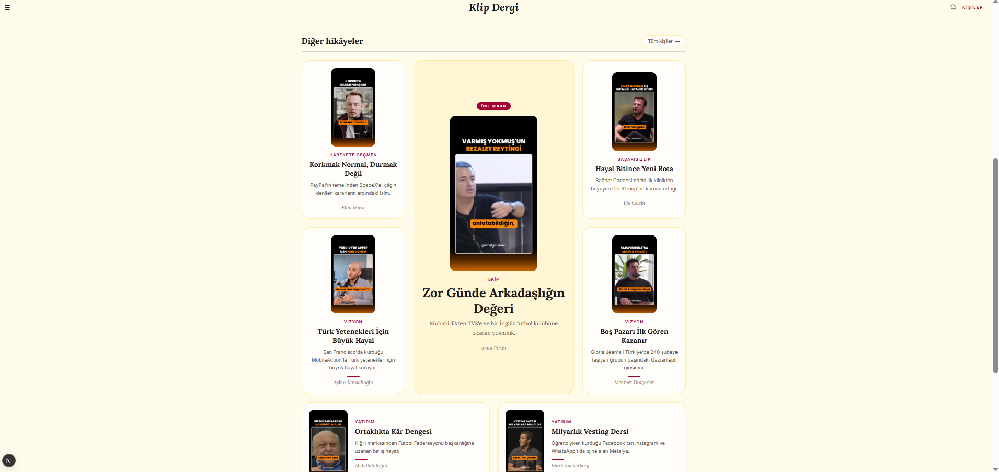
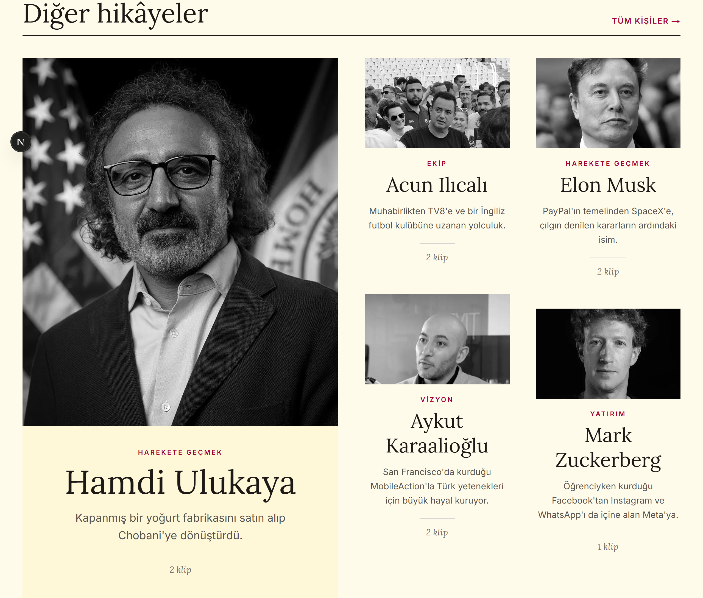
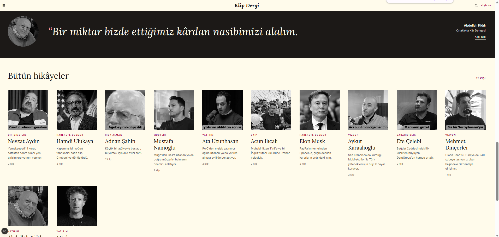
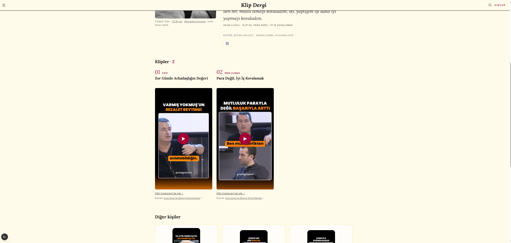
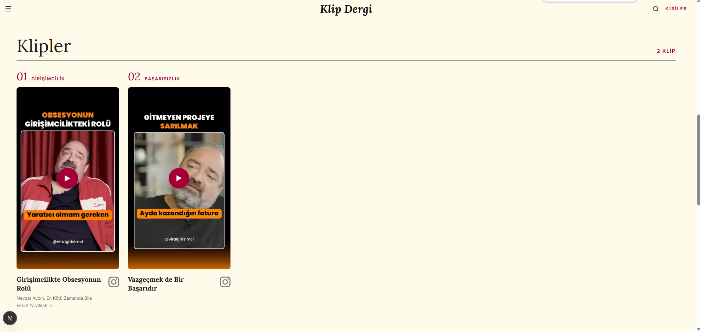
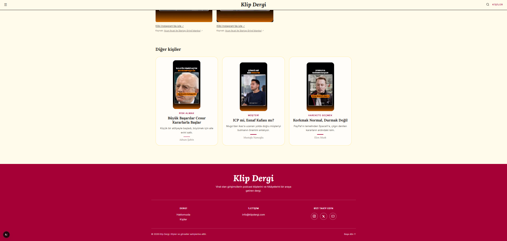
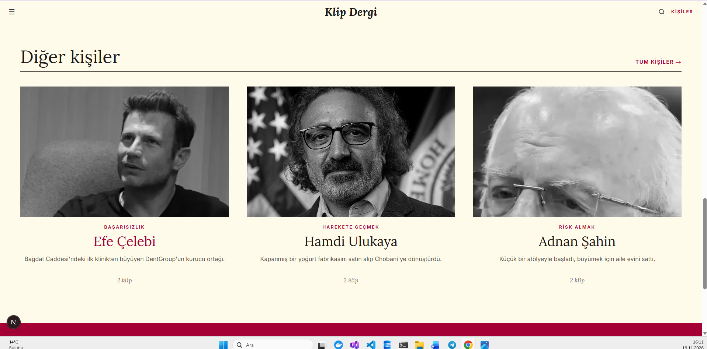
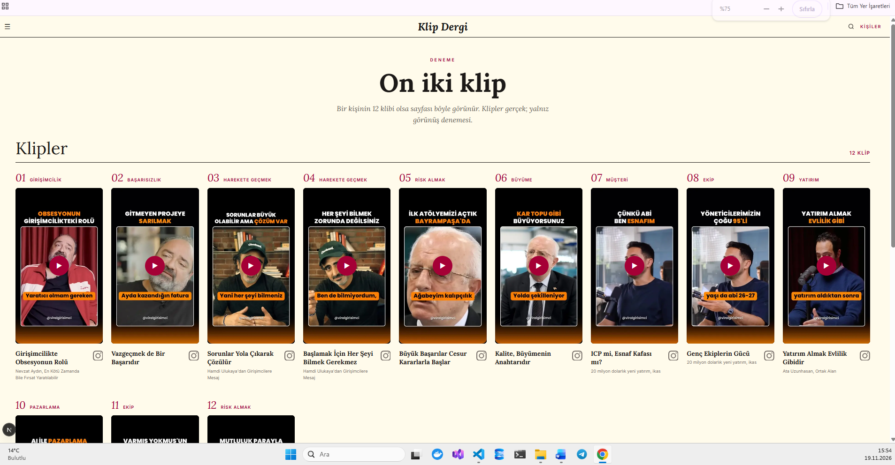

# Gün 21 · 18 Kasım Çarşamba planı · çalıştığım günler: 18–19 Kasım

Dal: `hafta5`

## Planın istediği

- **Diğer hikâyeler:** Kişi sayısı 4'ten fazla olunca satır satır dizilen albüm düzeni: `repeat(auto-fill, minmax(…, 1fr))`.
- **Kişi sayfasındaki klipler:** Yatay şerit klip arttıkça taşıyor → albüm (grid), kartlar biraz küçük.
- **Klip altı yazısı:** "Klibi Instagram'da izle" ve eski ikon kalksın. Yerine Lora klip başlığı, altında küçük gri kaynak satırı, yanında tek renk resmî Instagram glifi + link. Glif resmî kaynaktan, kendimiz çizmiyoruz.
- **Diğer kişiler:** Kartların arkasındaki beyaz zemin kalksın.
- **Çıktı:** Önce/sonra görüntüleri + 12 klip olsa nasıl görüneceği (deneme verisi).

📚 Kaynaklar: MDN CSS Grid · Instagram resmî glifi (Meta Marka Kaynak Merkezi)

## Durum

| # | Madde | Durum | Commit |
|---|---|---|---|
| 0 | Önce ekran görüntüleri | ✅ | `616c720` |
| 1 | Diğer hikâyeler → albüm | ✅ (3 deneme sonunda yeni ana sayfa düzeni) | `8fcccd2` · `9bc1287` · `95b689b` |
| 2 | Kişi sayfası klipleri → albüm | ✅ | `f3c6fd9` · `3d62757` · `ab8d67c` |
| 3 | Klip altı: Lora başlık + kaynak + Instagram glifi | ✅ | `75e0775` |
| 4 | Beyaz zemin kalktı | ✅ | `e3e3b8e` |
| Çıktı | 12 kliplik deneme sayfası | ✅ | `3d62757` |
| Çıktı | Sonra ekran görüntüleri | ✅ | `6f6a642` |
| + | Vitrin titreşimi düzeltmesi | ✅ | `b0263f5` |
| + | Vitrin LCP uyarısı düzeltmesi | ✅ | `46e5081` |

375 px ve geniş ekran kontrolü yapıldı ✅

## Önce / sonra

**Diğer hikâyeler (ana sayfa)**

| Önce | Sonra |
|---|---|
|  |   |

**Klipler (kişi sayfası)**

| Önce | Sonra |
|---|---|
|  |  |

**Diğer kişiler (kişi sayfası)**

| Önce | Sonra |
|---|---|
|  |  |

**12 klip denemesi** (`/klip-deneme`)



link : https://klip-dergi-git-hafta5-symkllcis-projects.vercel.app/klip-deneme

## 1. Albüm ızgarası 📚 MDN CSS Grid

```css
grid-template-columns: repeat(auto-fill, minmax(min(230px, 100%), 1fr));
```

- `repeat(…)` = sütunu tekrarla · `auto-fill` = sığdığı kadar sütun aç · `minmax(230px, 1fr)` = her sütun en az 230 px, artan boşluk eşit paylaşılır.
- `min(230px, 100%)` = ekran 230 px'ten darsa kart taşmasın, ekran kadar olsun.
- `auto-fill` boş sütunları da tutar: 2 klipte sağda boş hücre kalır, kart dev gibi büyümez. (`auto-fit` olsaydı 2 klip ekrana yayılırdı.)
- Kişi ya da klip eklenince yeni satır kendiliğinden açılır, ek kod gerekmez.

## 2. Ana sayfa: Diğer hikâyeler (3 deneme)

1. **Sade albüm** (`minmax(240px)` + eski kart) → "çok düz" dedim.
2. **Alıntı duvarı** (her kartta alıntı, bazıları koyu ve 2 sütun) → kart boyları farklı, alıntısı olmayanlar boş görünüyordu.
3. **Son düzen** (hocamın örneğe göre):
   - **Diğer hikâyeler:** 12 sütunlu ızgara, öne çıkan 6 sütun + yanında 3+3 sütunluk iki kolon (`lg:grid-cols-12`). Kart kutusu yok, görsel siyah-beyaz.
   - **Alıntı bandı:** Tam genişlik koyu bant, sayfada tek alıntı (`AlintiBandi.tsx`). Alıntı yoksa bant çıkmaz (`return null`).
   - **Bütün hikâyeler:** 12 kişi, `auto-fill` albüm (`HikayeKarti.tsx`).
- **Editör seçimi** kodun en üstünde: `ONE_CIKAN = "hamdi-ulukaya"`, `YAN = [acun, elon, aykut, mark]`, `BANT = "abdullah-kigili"`. Değiştirmek için sadece adı değiştirmek yeterli.
- **Görsel kırpma:** fotoğraf `object-[50%_25%]` (saçın üstü sığsın), reel kapağı `scale-[1.15] object-[50%_40%]` (yanlardaki çerçeve dışarıda kalsın, yüz ortada).
- **Sayfa genişliği:** dar kutu (`max-w-6xl`) kalktı, yanlarda `px-[clamp(16px,3.2vw,56px)]`. Kişi sayfasında yalnız fotoğraf + biyografi dar kaldı (uzun satır okunmaz).

## 3. Kişi sayfası: klipler

- `KlipOynatici`: `w-[320px]` → `w-full`, iframe `aspect-[9/16]`. Oynatıcı hücre kadar.
- Albüm ayrı bileşende: `KlipAlbumu.tsx` (kişi sayfası + deneme sayfası kullanıyor; bir kez yaz, iki yerde kullan).
- 🐞 `0{sira + 1}` 10. klipte "010" yazıyordu → `String(sira + 1).padStart(2, "0")`. Hata 2 klipte görünmüyor, 12 kliplik denemede çıkıyor.

## 4. Klip altı ve Instagram glifi

- Glif: Meta Marka Kaynak Merkezi → Instagram → Logo paketi → `01 Static Glyph / 03 Black Glyph / Instagram_Glyph_Black.svg`.
- `InstagramGlifi.tsx`: çizim (path) harfi harfine aynı, tek değişiklik `fill="currentColor"` (Meta: "her düz renk olabilir").
- Meta kuralları: şekil değiştirilmez/döndürülmez · en küçük **29 × 29 px** · "Instagram" büyük I ile.
- Ekranda yazı yok; `aria-label` ve `title` = "Klibi Instagram'da izle".
- Kaynak satırı: bölüm başlığı (veride podcast adı yok → hocaya soru).

## 5. Beyaz zemin

`KlipKarti`: `buyuk ? "bg-amber-100/60" : "bg-white/70"` → `buyuk ? "bg-amber-100/60" : ""`. Her yerden kalktı (B seçeneği: site her yerde aynı görünsün). Kişi sayfasındaki "Diğer kişiler" artık `HikayeKarti` kullanıyor.

## 6. Vitrin düzeltmeleri

- **Titreşim:** Başlık `text-lg ↔ text-3xl` değişince kartın boyu değişiyor, sayfa her 5 sn'de zıplıyordu. Çözüm: başlık hep `text-3xl`, yanda `scale-[0.6]`. Kural: animasyonda boyut için `transform` (Lighthouse CLS).
- **LCP:** İlk ekranda (JS çalışmadan) şerit en soldan başlıyor, kopya kart görünüyor → `sira % adet === 0` (1. kişinin 3 kopyası) `eager`. Aynı dosya, bir kez iner.


**Kelimeler:** auto-fill / auto-fit · minmax · clamp (sıkıştır) · object-position · padStart (başa doldur) · flatMap (dök ve düzleştir) · find / filter · noindex · glif (glyph) · currentColor · transform / scale · CLS · `git restore` · `git rm`.


## Kaldığım yer

Çarşamba bitti. Sıradaki: **Perşembe planı** (yatay fotoğraf ve `object-position`, arama önerileri, combobox).