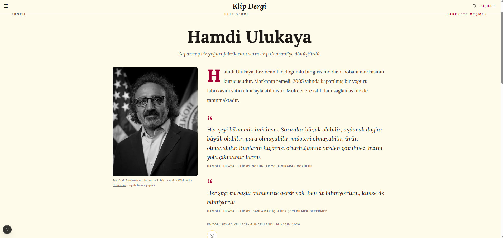
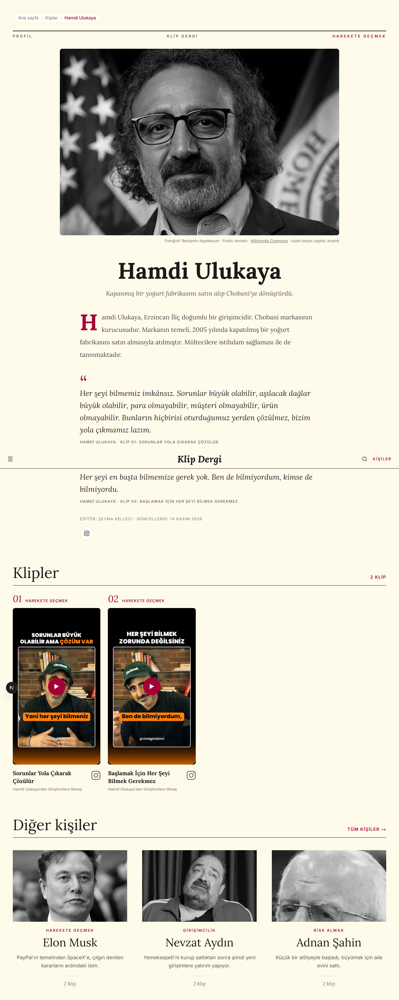
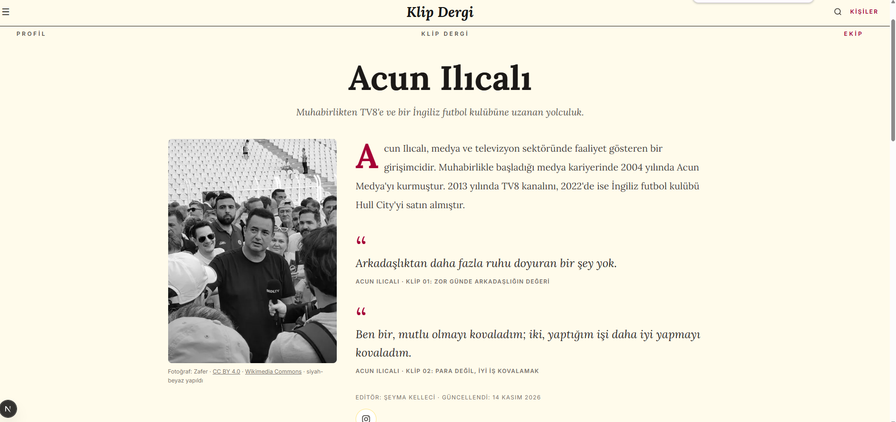
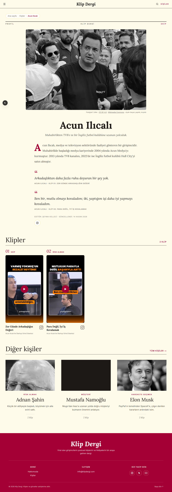
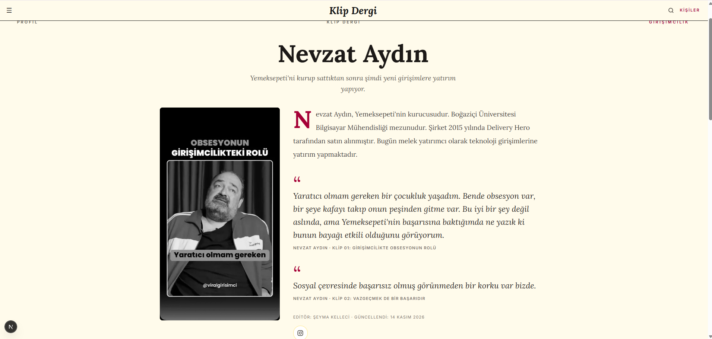
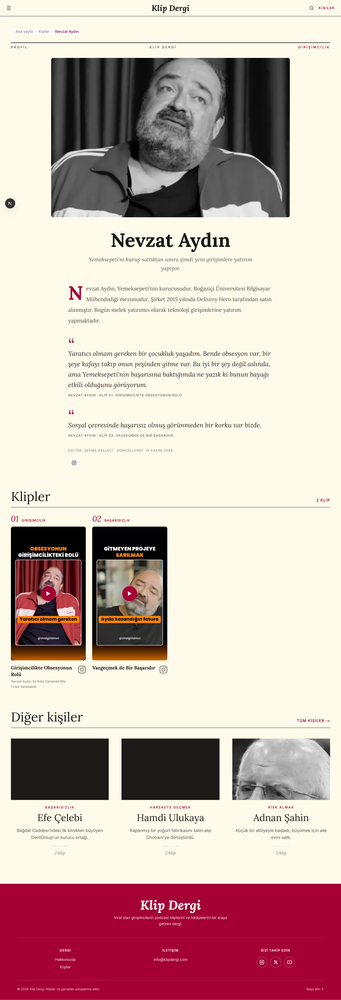

# Gün 22 · 19 Kasım Perşembe planı · çalıştığım gün: 19 Kasım

Dal: `hafta5`

## Planın istediği

- **Yatay fotoğraf:** Kişi sayfasında ismin üstüne yatay fotoğraf (16:9 veya 3:2), `object-position` ile yüz kesilmesin. Gerekirse Commons'tan 1280 px. Fotoğrafı olmayanda reel kapağı da aynı şekilde kırpılsın.
- **Arama önerileri:** En fazla 5 öneri, soyadıyla da eşleşsin ("ulu" → Hamdi Ulukaya), `toLocaleLowerCase("tr-TR")`.
- **Klavye ve erişilebilirlik:** Oklar, Enter, Esc; combobox kalıbı (`role="combobox"`, `aria-expanded`, listbox).
- **Çıktı:** 3 kişinin görüntüsü + sadece klavyeyle çekilmiş ekran kaydı.

📚 Kaynaklar: [MDN object-position](https://developer.mozilla.org/docs/Web/CSS/object-position) · [WAI-ARIA Combobox kalıbı](https://www.w3.org/WAI/ARIA/apg/patterns/combobox/) ⭐ ([Editable Combobox With List Autocomplete örneği](https://www.w3.org/WAI/ARIA/apg/patterns/combobox/examples/combobox-autocomplete-list/))

## Durum

| # | Madde | Durum | Commit |
|---|---|---|---|
| 0 | Önce görüntüleri (Hamdi, Acun, Nevzat) | ✅ | `dfc545d` |
| 1 | Yatay fotoğraf (3:2) + yüz odağı veriden | ✅ | `28e880a` |
| 1 | Sonra görüntüleri | ✅ | `f0abdd1` |
| 2–3 | Arama önerileri + klavye + combobox | ✅ | `0fb161e` |
| Çıktı | Sadece klavyeyle ekran kaydı (30 sn, 25,9 MB) | ✅ | Drive → 5. hafta klasörü (çalışma notlarımın yanında) |

375 px ve geniş ekran kontrolü yapıldı ✅

## Önce / sonra

| Kişi | Önce | Sonra |
|---|---|---|
| Hamdi (fotoğraf var) |  |  |
| Acun (kalabalık fotoğraf) |  |  |
| Nevzat (fotoğraf yok, reel kapağı) |  |  |

## 1. Yatay fotoğraf 📚 MDN object-position

> "The **object-position** CSS property specifies the alignment of the selected replaced element's contents within the element's box."

- Varsayılan `50% 50%` (orta). 1. değer yatay, 2. değer dikey. `object-fit: cover` resmi büyütüp kutuyu doldurur, `object-position` hangi kısmın görüneceğini seçer.
- **Neden 3:2?** Fotoğraflarımız dikey portre (960 × 1242, oran 1,29). 16:9 kutu fotoğrafın %43'ünü, 3:2 kutu %52'sini gösterir → 3:2 yüzü daha az keser. (Tahminim B ✅)
- **Yüz odağı veriden:** `types.ts` → `Photo`'ya `focus?: string`. `people.json`'da 5 fotoğrafa değer verildi:

| Kişi | focus |
|---|---|
| Hamdi | `50% 20%` |
| Acun | `45% 58%` (ilk denemede `45% 75%` → başı kesikti) |
| Elon | `50% 30%` |
| Abdullah | `50% 25%` |
| Mark | `50% 30%` |

- **Neden `style`?** Tailwind sınıfları (`object-[50%_20%]`) kod yazılırken hazırlanır; veriden sonradan gelen değerle çalışmaz → `style={{ objectPosition: kisi.photo.focus ?? "50% 25%" }}`.
- Fotoğrafı olmayanda reel kapağı: `scale-[1.15]` (yan çerçeve dışarıda) + `50% 45%`.
- Yeni sıra: künye → **yatay fotoğraf** (`max-w-4xl`) + atıf ("siyah-beyaz yapıldı, kırpıldı") → isim + kanca → tek sütun yazı (`max-w-3xl`). Sol fotoğraf sütunu kalktı.
- **Commons 1280:** 896 px kutuda 960 px dosya benim ekranımda net → "gerekirse" şartı şimdilik yok.

## 2. Arama önerileri

```ts
const kucult = (yazi: string) => yazi.toLocaleLowerCase("tr-TR");
// adın HERHANGİ bir kelimesi yazılanla başlıyorsa → soyadı da bulunur
kelimeler.some((kelime) => kelime.startsWith(aranan))
```

- `"ILICALI".toLowerCase()` → `"ilicali"` ❌ · `toLocaleLowerCase("tr-TR")` → `"ılıcalı"` ✅
- **"ulu"** → Hamdi Ulukaya ✅
- **"a"** → 5 öneri (Nevzat **A**ydın, Adnan, Ata, Acun, Aykut). Abdullah da eşleşiyor ama 6. → en fazla 5 ✅. Hamdi yok: adında "a" var ama hiçbir kelimesi "a" ile **başlamıyor** (`includes` değil `startsWith`).
- Tarayıcıya sadece **ad, slug, konu** gidiyor (`layout.tsx` sunucuda hazırlıyor), biyografiler gitmiyor.
- Yeni bileşen: `src/components/AramaKutusu.tsx`. `Header.tsx` onu kullanıyor.

## 3. Klavye 📚 WAI-ARIA Combobox

| Tuş | Ne yapar |
|---|---|
| **Tab** | 🔍 düğmesine gelir |
| **Enter** (🔍 üstünde) | Arama kutusunu açar |
| **↓** | Bir sonraki öneri; sondan sonra başa döner |
| **↑** | Bir önceki öneri; baştan önce sona döner |
| **Alt + ↓** | Sadece listeyi açar, vurgu değişmez |
| **Enter** (öneri vurguluysa) | O kişinin sayfasını açar |
| **Enter** (vurgu yoksa) | Kişiler sayfasında arar (`/kisiler?ara=…`) |
| **Esc** (1.) | Listeyi kapatır, yazı kalır |
| **Esc** (2.) | Yazıyı siler |
| **Esc** (3.) | Arama kutusunu kapatır |

## 4. Combobox etiketleri

| Nerede | Etiket | Ne işe yarar |
|---|---|---|
| Kutu | `role="combobox"` | "Ben öneri listesi olan bir kutuyum" |
| Kutu | `aria-autocomplete="list"` | Öneriler açılır listede, yazılana göre |
| Kutu | `aria-expanded` | Liste açık mı (`true` / `false`) |
| Kutu | `aria-controls` | Listenin kimliği (`useId` ile üretildi) |
| Kutu | `aria-activedescendant` | Odak kutuda kalır; vurgulanan önerinin kimliği burada |
| Liste | `role="listbox"` + `aria-label` | "Ben seçenek listesiyim: Kişi önerileri" |
| Öneri | `role="option"` | "Ben bir seçeneğim" |
| Öneri | `aria-selected` | Sadece vurgulanan öneride `true` |

**Kodda neden var?**
- `e.preventDefault()` (↓ ↑): imleç kutunun başına/sonuna zıplamasın.
- `e.preventDefault()` (Esc): `type="search"` kutuda tarayıcı Esc'de yazıyı **kendisi siliyordu** → ilk Esc hem kapatıp hem siliyordu. Bunu ekran testinde yakaladım 🐞
- `e.stopPropagation()` (Esc): Header'ın "Esc'de aramayı kapat" kulağına gitmesin; önce listeyi kapatıyoruz.
- `onMouseDown={(e) => e.preventDefault()}` (öneri): tıklayınca kutu odağı kaybetmesin, yoksa `onBlur` aramayı kapatıp tıklamayı yutardı.
- `autoComplete="off"`: tarayıcının kendi eski aramalar listesi bizimkinin üstüne binmesin.

## Takıldığım yerler

- `Property 'focus' does not exist on type 'Photo'`: `types.ts` güncellenmemişti. Tip = verinin kimlik kartı; kartta olmayan bilgiyi kabul etmiyor.
- `[slug]/page.tsx` sekmesinde ● gördüm ama `git status` → "working tree clean": diskteki dosya doğruydu, sekmeyi kaydetmeden kapattım.
- Video 25,9 MB → GitHub yerine Drive.

**Kelimeler:** object-position · aspect ratio (en-boy oranı) · focus (odak) · combobox · listbox · option · aria-activedescendant · useId · preventDefault · stopPropagation · toLocaleLowerCase · startsWith / includes.

## Kaldığım yer

Perşembe bitti. Sıradaki: **Cuma planı** (turkce-asr-ozel-isim reposu, Wikidata P18, fork'tan PR).