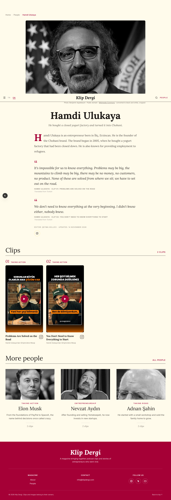

# Gün 26 · 24 Kasım Salı planı · çalıştığım gün: 26 Kasım

> 6\. haftaya 1 gün geç başladım. Pazartesi planını 24 Kasım'da, Salı planını 25-26 Kasım'da yaptım.

Dal: `hafta6`

## Planın istediği

- Bütün sayfaların `/en` altında İngilizcesi olsun, Türkçe adresler değişmesin
- Arayüz yazıları (menü, düğmeler, başlıklar) bir sözlük dosyasında dursun, sayfalar oradan okusun
- 12 biyografinin ve kancanın İngilizcesi `people.json`'da ayrı alan olsun; yapay zekâya çevrilebilir ama okuyup kontrol et; kişi adları çevrilmez
- Başlıkta TR/EN düğmesi; her sayfada hreflang
- Çıktı: Hamdi'nin sayfasının iki dildeki ekran görüntüsü

📚 Kaynak: [Next.js Internationalization](https://nextjs.org/docs/app/guides/internationalization)

## Yaptıklarım

| # | Ne yaptım | Commit |
|---|---|---|
| 1 | Sayfalar `app/[lang]/` altına taşındı (`git mv`), `src/proxy.ts`: Türkçe adresler aynı, `/en` İngilizce | `10b8985` |
| 2 | Sözlük: `src/sozluk/tr.json`, `en.json` + `src/lib/sozluk.ts`; 15 dosya sözlükten okuyor | `3424a4f` |
| 3 | 12 kişinin biyografi ve kancasının İngilizcesi (`bioEn`, `dekEn`) | `226a977` |
| 4 | Ek: 21 klip başlığı (`titleEn`) ve 18 alıntının (`quoteEn`) İngilizcesi, alıntının altında "Translated from Turkish" | `5431730` |
| 5 | Başlıkta TR · EN düğmesi (aynı sayfanın öbür dili), telefonda logo tek satır | `b5482f2` |
| 6 | Her sayfada hreflang (tr, en, x-default) ve canonical | `182afc1` |
| 7 | Hamdi'nin sayfası iki dilde ekran görüntüsü | `59ecdfa` |

## 1. Adresler: `[lang]` + proxy

Next.js belgesindeki yol: bütün sayfalar `app/[lang]/` içinde, `[lang]` yerine `tr` ya da `en` gelir. Türkçe adresler değişmesin diye `src/proxy.ts` kapıdaki görevli gibi çalışıyor:

| Ziyaretçi yazar | Proxy ne yapar | Adres çubuğu |
|---|---|---|
| `/kisiler` | içeride `/tr/kisiler` açar (rewrite) | `/kisiler` |
| `/en/kisiler` | dokunmaz | `/en/kisiler` |
| `/tr/kisiler` | `/kisiler`'e gönderir (redirect) | `/kisiler` |
| `/de` | | 404 |

- `layout.tsx`: `generateStaticParams` (tr, en), `dynamicParams = false`, `<html lang={dil}>`
- 7 dosya `git mv` ile taşındı, Git "renamed (100%)" dedi
- `.next` silinince `LayoutProps` bulunamadı → `npx next typegen`

## 2. Sözlük

`tr.json` ve `en.json` aynı anahtarlara sahip (ikisi de 117 satır). Sayfa yazıyı ezbere bilmiyor, sözlükten okuyor: `{s.footer.takip}` → "Bizi takip edin" / "Follow us".

`lib/sozluk.ts`:

| Fonksiyon | Ne yapar |
|---|---|
| `getSozluk(dil)` | o dilin sözlüğü |
| `yol(dil, adres)` | `yol("en", "/kisiler")` → `/en/kisiler` |
| `konuAdi(s, konu)` | `"yatırım"` → `"investment"` (adreste Türkçe kalır) |
| `klipSayisi(s, n)` | "1 clip" / "2 clips" |
| `dilAdresleri(dil, adres)` | hreflang ve canonical |

`const en: Sozluk = enVerisi` → İngilizce sözlükte bir anahtar eksik kalırsa TypeScript söyler.

## 3. Biyografi, kanca, başlık, alıntı

- `people.json`: `bioEn`, `dekEn` (12 kişi), klip notlarında `titleEn` (21), `quoteEn` (18)
- `lib/people.ts`: `getAllPeople(dil)` İngilizcede `bio` yerine `bioEn` koyuyor; sayfalar değişmeden `kisi.bio` okuyor
- Kişi ve şirket adları çevrilmedi. Türkçede olmayan bilgi eklenmedi. 12 kancayı Türkçeyle yan yana okuyup kontrol ettim.
- Alıntı kişinin Türkçe sözü → İngilizcesinin altında küçük gri **"Translated from Turkish"**
- YouTube video adı (kaynak) çevrilmedi: videonun gerçek adı

## 4. TR · EN düğmesi

Solda, ☰'nin yanında. Seçili dil bordo ve altı çizili; diğeri gri link, aynı sayfanın öbür diline gider (`/kisiler/hamdi-ulukaya` ↔ `/en/kisiler/hamdi-ulukaya`).

Önce sağa koydum, 375 px'te büyüteç logonun üstüne bindi → sola aldım. Sonra telefonda logo iki satıra iniyordu ve TR · EN'e çok yakındı: başlık `grid-cols-[1fr_auto_1fr]`, logo `whitespace-nowrap`, telefonda bir boy küçük → 375 px'te logoya uzaklık 16 px'ten 32 px'e çıktı, 320 px'te de çakışma yok.

## 5. hreflang

Her sayfanın `<head>`'inde (view-source ile kontrol ettim):

```html
<link rel="canonical" href=".../en/kisiler/hamdi-ulukaya"/>
<link rel="alternate" hrefLang="tr" href=".../kisiler/hamdi-ulukaya"/>
<link rel="alternate" hrefLang="en" href=".../en/kisiler/hamdi-ulukaya"/>
<link rel="alternate" hrefLang="x-default" href=".../kisiler/hamdi-ulukaya"/>
```

## Çıktı: Hamdi iki dilde

| Türkçe | İngilizce |
|---|---|
|  |  |

## Karşılaştığım sorunlar

| Sorun | Sebep | Çözüm |
|---|---|---|
| `New-Item -LiteralPath` hata | Bu komutta o seçenek yok | `New-Item -ItemType Directory -Path "src/app" -Name "[lang]"` |
| `git mv … page.tsx` → "bad source" | Komut iki kez çalışmış, dosya zaten taşınmıştı | `git status` ile kontrol |
| `Cannot find name 'LayoutProps'` | `.next` silinince Next.js'in ürettiği tipler de gitti | `npx next typegen` |
| "Hydration failed" (lang en → tr, "Breadcrumb" → "Ekmek kırıntısı") | Chrome İngilizce sayfayı kendisi Türkçeye çevirdi | Chrome'da "İngilizce'yi asla çevirme" |
| Ekran görüntüsü `.png.png` | Kaydetme penceresi uzantıyı kendisi ekliyor | `Rename-Item` |

Her adımda Türkçe sayfaların 16'sı da eskisiyle birebir aynı kaldı ✅