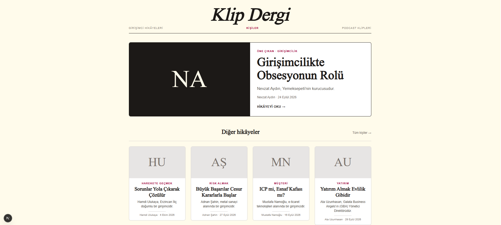
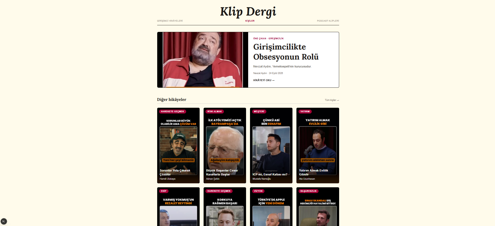
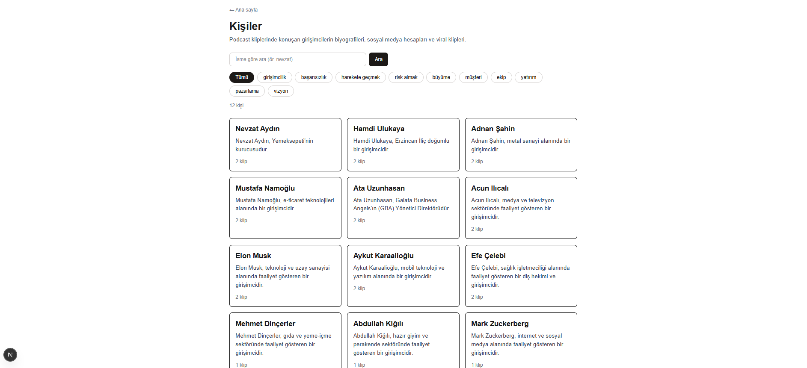
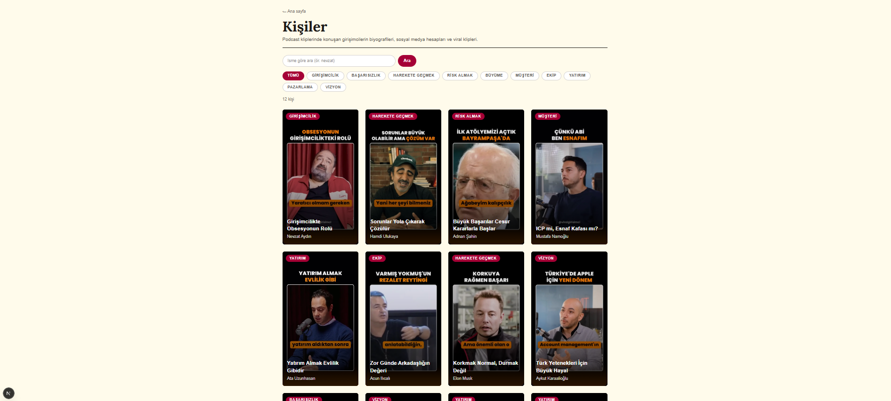

# Gün 10 · Çarşamba (4 Kasım) planı · çalıştığım gün: 7 Kasım

Dal: `hafta3`

## Planın istediği

- Baş harfli gri kutular yerine **dikey kapak kartı** (Reels oranı, 9:16): kapak görseli kartı tamamen kaplar, alt kısım koyuya doğru geçer, başlık görselin üstünde beyaz, köşede konu etiketi. Fare üstüne gelince görsel hafifçe büyür.
- Görseli **`next/image`** ile göster (`fill` ve `object-cover`). Neden `` değil: Next.js görseli küçültüp hızlı yükletiyor, Lighthouse puanını etkiliyor.
- Kartı **ayrı bir bileşen** yap (`KlipKarti`), ana sayfa ve kişiler sayfası ikisi de bunu kullansın.
- Kişiler sayfasını ana sayfanın temasına çek: krem zemin, Lora başlık, bordo vurgu. Filtre düğmeleri de aynı dili alsın.
- **Çıktı:** İki sayfada aynı kart, önce/sonra ekran görüntüsü.

## Bugün ne yaptım

- Kod değişmeden önce iki sayfanın **"önce"** ekran görüntüsünü aldım.
- `src/components/KlipKarti.tsx` bileşenini yazdım: 9:16 kapak, koyu geçiş, beyaz başlık, kişi adı, bordo konu etiketi, hover'da büyüme.
- **Ana sayfa:** "Diğer hikâyeler"deki gri baş harf kartları yerine `KlipKarti`. Öne çıkan bölümdeki büyük "NA" kutusu yerine kapak resmi. `loading="eager"` ekledim.
- Pazartesi'den kalan gizli bir hatayı buldum: `id="hikayeler"` boş bir div'deydi, doğru başlığa taşıdım.
- Artık kullanılmayan `HikayeKarti` ve `basHarfler`'i sildim.
- **Kişiler sayfası:** Eski yazı kartları yerine `KlipKarti`. Konu seçiliyse kart o konudaki klibi gösteriyor (`find`).
- **Kişiler sayfası teması:** krem zemin, Lora başlık, bordo vurgu, kart etiketi gibi filtre düğmeleri.
- **"Sonra"** ekran görüntülerini aldım.

## Önce / sonra

| | Önce | Sonra |
|---|---|---|
| Ana sayfa |  |  |
| Kişiler |  |  |

## Neden ayrı bileşen?

Kart kodunu her klip için ayrı yazmıyoruz, `map` tek kalıpla bütün kartları basıyor (**kurabiye kalıbı**). Sorun iki sayfaydı: Ana sayfada bir kart kodu, kişiler sayfasında başka bir kart kodu olsaydı **2 kalıp** olurdu. Köşeyi yuvarlamak için 2 dosyayı değiştirmem gerekirdi, birini unutursam iki sayfa farklı görünürdü. `KlipKarti.tsx` ile **1 kalıp, 1 dosya**, iki sayfa birden değişiyor.

İlk cevabım "21 klipte değiştirmem lazım" idi. Yönüm doğruydu, sayım yanlıştı: map sayesinde 21 değil, sayfa sayısı kadar.

## Kartın tasarımı

### Kart neyi nereden alıyor?

| Kartta ne var | Nereden | Alan |
|---|---|---|
| Kapak resmi | Klip | `klip.cover` |
| Beyaz başlık | Klip | `klip.title` |
| Köşedeki konu etiketi | Klip | `klip.topic` |
| Kişinin adı | Kişi | `kisi.name` |
| Gideceği adres | Kişi | `kisi.slug` |

Konu etiketini önce "klip mi kişi mi" bilemedim. Konu **klibe** ait, çünkü bir kişinin farklı konularda klipleri var (Acun: ekip + risk almak).

### Katmanlar (sandviç)

```
┌───────────────────┐
│ [KONU ETİKETİ]    │  ← 4. katman: sol üst köşe, bordo
│                   │
│   kapak resmi     │  ← 1. katman: kutuyu tamamen kaplar
│                   │
│▓▓▓▓▓▓▓▓▓▓▓▓▓▓▓▓▓▓▓│  ← 2. katman: alttan yukarı koyulaşan geçiş
│ Başlık (beyaz)    │  ← 3. katman: başlık + kişi adı
│ Kişi adı          │
└───────────────────┘
```

Dosyada önce yazılan **altta**, sonra yazılan **üstte** durur.

**Koyu geçiş neden?** Benim cevabım: Açık renkli bir kapakta beyaz yazı görünmezdi. Koyu geçiş kapak ne renk olursa olsun başlığın okunmasını sağlıyor.

### Tıklanınca nereye?

Planda yazmıyordu, karar benim oldu. Kartı **kişinin sayfasına** bağladım (`/kisiler/slug`), Instagram'a değil: Ziyaretçi sitede kalıyor, bio'yu ve diğer klipleri görüyor. Kişi sayfasında zaten "Klibi Instagram'da izle" linki var.

## next/image: fill ve object-cover

Kaynak: [Next.js Image](https://nextjs.org/docs/app/api-reference/components/image) → `fill` bölümü.

- **`fill`:** Genişliği ve yüksekliği önceden bilmiyorsak kullanılır (bizim kartlar ekrana göre değişiyor). Resim kendi boyutunu bilmez, onu **saran kutuyu** (parent) doldurur. İçeride `position: absolute` alır.
- **Şart 1:** Saran kutu `relative` olmalı. Absolute bir şey en yakın relative kutuya yapışır, yoksa sayfaya yapışıp karttan taşar.
- **Şart 2:** Saran kutunun bir boyutu olmalı. 0 ise resim görünmez.
- **Benzetme:** `fill` su gibi. `relative` "bardak bu" demek, boyut bardağın büyüklüğü. Bardak yoksa su yere yayılır.
- **`object-cover`:** Kutuyu tamamen doldurur, taşanı kırpar, resmi **ezmez**. Yoksa resim esner, yüzler uzar.
- **`sizes`:** Tarayıcıya resmin ekranda ne kadar yer kaplayacağını söyler. Next.js de o boyutta resim gönderir, gereksiz büyük resim inmez (hocanın "küçültüp hızlı yükletiyor"u).
  - Kart: `(min-width: 1024px) 25vw, (min-width: 640px) 50vw, 100vw`
  - Öne çıkan: `(min-width: 768px) 50vw, 100vw`
  - `vw` = ekran genişliği, 100vw = ekranın tamamı.

### 9:16 oranı

İlk cevabım `aspect-ratio` idi. O CSS'teki **özelliğin adı**. Tailwind sınıfı: `aspect-[9/16]`.

| | Yazım |
|---|---|
| CSS | `aspect-ratio: 9 / 16;` |
| Tailwind | `aspect-[9/16]` |

`aspect-` = özellik, `[9/16]` = kendi değerim (köşeli parantez = hazır listede yok, `bg-[#...]` gibi). Hazır oranlar: `aspect-square` (1:1), `aspect-video` (16:9 yatay). Dikey hazır yok.

**Özet:** Dış kutu `relative aspect-[9/16]`, resim `fill` + `object-cover`. Genişliği sayfa belirliyor, yüksekliği oran hesaplıyor.

## KlipKarti.tsx

```tsx
import Image from "next/image"; // Next.js'in resim bileşeni: resmi küçültüp hızlı yükler
import Link from "next/link"; // Next.js'in link bileşeni: site içi sayfalara geçiş
import type { Person, Clip } from "@/types"; // Bizim kalıplarımız: kişi ve klip

// Bir klibi dikey kapak kartı olarak gösteren bileşen. Ana sayfa ve kişiler sayfası kullanıyor.
export default function KlipKarti({ kisi, klip }: { kisi: Person; klip: Clip }) {
  return (
    // Bütün kart bir link: tıklanınca kişinin sayfasına gider
    <Link href={`/kisiler/${kisi.slug}`} className="group block">
      {/* 9:16 kutu: resim bu kutuyu dolduracak */}
      <div className="relative aspect-[9/16] overflow-hidden rounded-lg bg-stone-900">
        {/* 1. katman: kapak resmi */}
        <Image src={klip.cover} alt={klip.title} fill
          sizes="(min-width: 1024px) 25vw, (min-width: 640px) 50vw, 100vw"
          className="object-cover transition-transform duration-500 group-hover:scale-105" />
        {/* 2. katman: koyu geçiş */}
        <div className="absolute inset-0 bg-gradient-to-t from-black/80 via-black/20 to-transparent" />
        {/* 3. katman: başlık ve kişi adı */}
        <div className="absolute bottom-0 left-0 right-0 p-4 text-white">
          <h3 className="text-lg font-bold leading-snug">{klip.title}</h3>
          <p className="mt-1 text-sm text-white/80">{kisi.name}</p>
        </div>
        {/* 4. katman: konu etiketi */}
        <span className="absolute left-3 top-3 rounded-full bg-rose-800 px-3 py-1 text-xs font-semibold uppercase tracking-widest text-white">
          {klip.topic}
        </span>
      </div>
    </Link>
  );
}
```

### Kartın sınıfları

| Sınıf | Ne yapıyor |
|---|---|
| `group` | Fare kartın herhangi bir yerine gelince içerideki `group-hover:` sınıfları çalışsın |
| `block` | Link normalde satır içi durur, kutu gibi davransın |
| `relative aspect-[9/16]` | Bardak bu, oranı 9:16 |
| `overflow-hidden` | Büyüyen resim karttan taşmasın |
| `rounded-lg` | Yuvarlak köşe |
| `bg-stone-900` | Resim yüklenene kadar koyu zemin |
| `transition-transform duration-500` | Büyüme yarım saniyede, yumuşak |
| `group-hover:scale-105` | Fare karttayken resim %5 büyüsün |
| `absolute inset-0` | Kartın dört kenarına yapış, tamamını kapla |
| `bg-gradient-to-t` | Renk geçişi, alttan üste (to top) |
| `from-black/80 via-black/20 to-transparent` | Altta %80 siyah, ortada %20, üstte şeffaf |
| `absolute bottom-0 left-0 right-0` | Alta yapış, soldan sağa uzan |
| `text-white/80` | %80 beyaz, kişi adı başlıktan geri planda |
| `absolute left-3 top-3` | Sol üst köşe |
| `uppercase tracking-widest` | BÜYÜK HARF, harfler aralıklı. `lang="tr"` sayesinde "EKİP"teki İ noktalı. |

`/80` = yüzde 80 opaklık. `` href={`/kisiler/${kisi.slug}`} ``: ters tırnak ve `${...}` = yazının içine değer koymak.

## Import'larda öğrendiklerim

```
import  AD    from  "NEREDEN";
```

| Yazım | Ne demek | Örnek |
|---|---|---|
| `"next/..."` | Next.js paketi (`@` yok) | `"next/image"`, `"next/link"` |
| `"@/..."` | Bizim `src` klasörümüz | `"@/types"`, `"@/components/KlipKarti"` |

| Dosyada nasıl verildi | Nasıl alınır |
|---|---|
| `export default function KlipKarti` (dosyanın ana parçası) | `import KlipKarti from "..."` (süslü yok) |
| `export type Person` (birden fazla şey) | `import type { Person, Clip } from "..."` (süslü + virgül) |

- `type` sadece kalıplar için (`Person`, `Clip`). `KlipKarti` gerçek bir bileşen, `type` yazılmaz.
- `"@/components"` bir klasör, dosya adı da yazılmalı (`.tsx` olmadan).
- `export default` = "bu bileşeni dışarı ver, başka dosyalar kullanabilsin".
- Gri altı çizili import = henüz kullanılmadı, hata değil.

## Kalıp adı, değişken, alan

| Ne | Örnek | Ne işe yarar |
|---|---|---|
| Kalıp adı (büyük harf) | `Person`, `Clip` | Sadece "bu ne tür bir şey": `klip: Clip` |
| Değişken (küçük harf) | `kisi`, `klip` | Elimizdeki gerçek bilgi |
| Alan (noktadan sonra) | `kisi.name`, `klip.title` | O bilginin içinden bir parça |

Ekrana yazarken hep **değişken.alan**. `Clip` ve `Person` noktadan sonra hiç gelmez. (`kisi.____` boşluğuna önce "Clip" yazmıştım, doğrusu `name`.)

## Ana sayfa

- `<HikayeKarti kisi={kisi} />` → `<KlipKarti kisi={kisi} klip={kisi.clips[0]} />`. `clips[0]` = ilk klip.
- İlk denemede eski satırı silmeden yenisini ekledim, ekranda iki kart üst üste çıktı.
- **NA kutusu** da "baş harfli kutu", yerine öne çıkan klibin kapağını koydum. NA kutusunda boyut vardı (`h-64`, `md:min-h-80`), ama `relative` yoktu, ekledim. Harfleri ortalayan `flex items-center text-8xl` gibi sınıflar gitti. Hover'da bordo zemin yerine resim büyüyor, kartlarla aynı dil.

### LCP ve loading="eager"

Terminalde şu uyarı çıktı: *Image ... was detected as the Largest Contentful Paint (LCP). Please add `loading="eager"` if this image is above the fold.*

| Kelime | Okunuşu | Anlamı |
|---|---|---|
| LCP (Largest Contentful Paint) | el-si-pi | İlk ekrandaki en büyük şeyin çizilme zamanı, Google hızı bununla ölçüyor |
| above the fold | ıbav dı fold | Kaydırmadan görünen kısım, gazetenin katın üstü |
| `loading="eager"` | lo-ding iigır | Hemen yükle |
| lazy | leyzi | Tembel: ekranda değilse bekle (next/image'ın varsayılanı) |

`loading="eager"`'ı sadece öne çıkan kapağa ekledim. Aşağıdaki kartlar tembel kalsın. **Restoran:** ekmek önce (eager), tatlı sonra (lazy).

Aynı uyarı kişiler sayfasında Hamdi'nin kartı için de çıktı. Kişiler sayfasında ilk kart ilk ekranda kalıyor. Buna Cuma'daki Lighthouse işinde bakacağım.

### Pazartesi'den kalan gizli hata

`id="hikayeler"`'i mevcut div'e eklemek yerine onun içine **boş yeni bir div** yapıştırmışım. Fazladan bir çizgi ve boşluk oluşmuş, "Diğer hikâyeler" yazısı kaymıştı. Boş div'i silip `id`'yi başlık kutusuna taşıdım. (Ctrl + Shift + K = satırı komple sil.)

### Temizlik

`HikayeKarti` ve `basHarfler` artık kullanılmıyordu (VS Code'da soluk). Sildim, `import type { Person }` da onunla boşta kaldığı için gitti. `tarihYaz` kaldı, çünkü öne çıkandaki tarih satırında kullanılıyor.

- **"İleride lazım olursa?"** diye sordum. Kod eski commit'lerde duruyor: GitHub'da dosya → History, ya da `git show b3bedf9:src/app/page.tsx`. Git bir arşiv deposu.
- **"Yorum satırı yapsam olmaz mı?"** diye sordum. Olur, ama yorumdaki kod eskir (kalıp değişirse çalışmaz, kimse fark etmez), dosya kalabalık olur. Yedek zaten Git'te. Sildim.
- Bir yorum gerçekten eskimişti: "5 kişiyi al" → "Bütün kişileri al (şu an 12)".

## Kişiler sayfası

### Kart hangi klibi göstermeli?

"risk almak" filtresinde Acun çıkıyor, ama ilk klibinin konusu "ekip". Kart `clips[0]`'ı gösterseydi köşede **EKİP** yazacaktı. Konu seçiliyse **o konudaki** klibi göstermek için Pazartesi'nin araçlarından `find`'ı seçtim (tek klip, uyan ilki):

```tsx
const klip = kisi.clips.find((c) => c.topic === seciliKonu) ?? kisi.clips[0];
```

- `??` (iki soru işareti) = "soldaki boşsa (undefined) sağdakini al".
- Konu seçiliyken `find` o klibi bulur. Seçili değilken bulamaz, `undefined` döner, `??` ilk klibi verir.
- `map((kisi) => { ... return (...) })` **süslü parantez**: Kartı göstermeden önce bir satır hesap var. Normal parantez `( )` doğrudan gösterir.

Test: Tümü → Acun EKİP. risk almak → Adnan, Acun ("Para Değil, İyi İş Kovalamak"), Elon ("Çılgın Denilen Karar"), hepsi RİSK ALMAK 

### Tema

| Yer | Önce | Sonra |
|---|---|---|
| Zemin | beyaz | `<div className="min-h-screen bg-amber-50 text-stone-900">` |
| Genişlik | `max-w-5xl p-6` | `max-w-6xl px-6 py-10` (ana sayfayla aynı) |
| Başlık | `text-3xl font-bold` | Lora, `text-4xl sm:text-5xl`, altında `border-b-2` çizgi |
| Gri yazılar | `text-gray-...` | `text-stone-...` (sıcak gri) |
| ← Ana sayfa | `hover:underline` | `hover:text-rose-800` |
| Arama kutusu | köşeli, gri | `rounded-full bg-white focus:border-rose-800 focus:outline-none` |
| Ara düğmesi | siyah | `bg-rose-800 hover:bg-rose-900` |
| Filtre düğmeleri | siyah/gri, küçük harf | kart etiketi gibi: `rounded-full uppercase text-xs tracking-widest`, seçili bordo |

- `min-h-screen` = en az ekran boyu, krem zemin sayfanın sonuna kadar uzansın.
- `focus:` = kutuya tıklandığında. `outline-none` = tarayıcının mavi çerçevesini kapat.
- **"Aynı dil":** Düğmedeki "RİSK ALMAK" ile kartın köşesindeki "RİSK ALMAK" aynı görünüyor, ziyaretçi ikisini bağlıyor.
- `dugmeTemel`, `dugmeSecili`, `dugmeNormal`: İki düğmede tekrar eden uzun sınıfları bir kere tanımladım. Kurabiye kalıbı, küçük ölçekte.
- Lora iki dosyada da tanımlı. İdeal değil ama tek satır, ileride ortak bir dosyaya taşınabilir.
- Adım 1'de `<div>` açıp sondaki `</div>`'i unuttum. Kutu içinde kutu: önce içteki kapanır (`</main>`), sonra dıştaki (`</div>`).
- Mantığa (arama, filtre, find) dokunmadım, sadece görünüş değişti.

## Nerede takıldım

- **Dosya adı:** `git add notlar/gun10-ana-once.png` yazdım, dosyanın adı `gun10-anasyf-once.png`'ydi → `fatal: pathspec ... did not match any files`. `git add` hiçbir şey eklemedi, commit "nothing added", push "Everything up-to-date" dedi. **fatal** = komut tamamen durdu. Çözüm: doğru ad, ya da Tab ile tamamlamak.
- Resim commit'inde `0 insertions`: Git metin satırı sayar, resimler satır değil. `create mode 100644` dosyanın oluştuğunu gösteriyor.
- **Üç page.tsx karıştı.** Yol çubuğu ve fonksiyon adı ile ayırt ediyorum:

| Yol çubuğu | Fonksiyon | Adres |
|---|---|---|
| `src › app › page.tsx` | `Home` | `/` |
| `src › app › kisiler › page.tsx` | `KisilerSayfasi` | `/kisiler` |
| `src › app › kisiler › [slug] › page.tsx` | `KisiSayfasi` | `/kisiler/nevzat-aydin` |

- Ctrl + P → `kisiler/page` ile hızlı açılıyor.
- `import people from "@next/image"` yazdım: ad `Image`, paket `"next/image"` olmalıydı.
- Terminal: *Failed to download Geist from Google Fonts. Using a fallback font instead.* İnternet o an bağlanamamış, yedek font kullanılmış. ⚠ uyarı, hata değil.
- Adreste `harekete+ge%C3%A7mek`: boşluk `+`, ç `%C3%A7` oldu. Slug'da neden ç ve ı kullanmadığımızın örneği.

## Kelimeler

| Kelime | Okunuşu | Anlamı |
|---|---|---|
| component (bileşen) | kım-po-nınt | Tekrar kullanılan arayüz parçası |
| props | props | Bileşene verilen bilgiler (`kisi`, `klip`) |
| parent | pe-rınt | Saran kutu |
| fill | fil | Saran kutuyu doldur |
| object-cover | ob-cekt kavır | Ezmeden doldur, taşanı kırp |
| aspect ratio | es-pekt rey-şo | En-boy oranı |
| gradient | grey-di-ınt | Renk geçişi |
| overflow | o-vır-flo | Taşma |
| hover | ho-vır | Fare üstüne gelince |
| focus | fo-kıs | Tıklanıp seçili olunca |
| opacity | o-pa-si-ti | Opaklık (/80) |
| lazy / eager | leyzi / iigır | Tembel / hemen |
| LCP | el-si-pi | En büyük içeriğin çizilme zamanı |
| fallback | fol-bek | Yedek |
| nullish coalescing (`??`) | na-liş ko-ı-le-sing | Soldaki boşsa sağdaki |
| pathspec | peth-spek | Git'e verilen dosya yolu |

## Commit'lerim

1. `Çarşamba için önce ekran görüntülerini ekle`
2. `KlipKarti bileşenini ekle`
3. `Ana sayfada diğer hikâyeleri KlipKarti ile göster`
4. `hikayeler bağlantısını doğru başlığa taşı`
5. `Öne çıkan bölümde baş harf yerine kapak göster`
6. `Öne çıkan kapağı hemen yükle`
7. `Kullanılmayan HikayeKarti ve basHarfler'i kaldır`
8. `Kişiler sayfasında KlipKarti kullan`
9. `Kişiler sayfasını ana sayfa temasına çek`
10. `Çarşamba için sonra ekran görüntülerini ekle`

İşleri kendim parçaladım: kartlar çalışınca önce onu commit'ledim, `id` düzeltmesini ve NA kutusunu ayrı commit'lere ayırdım.
