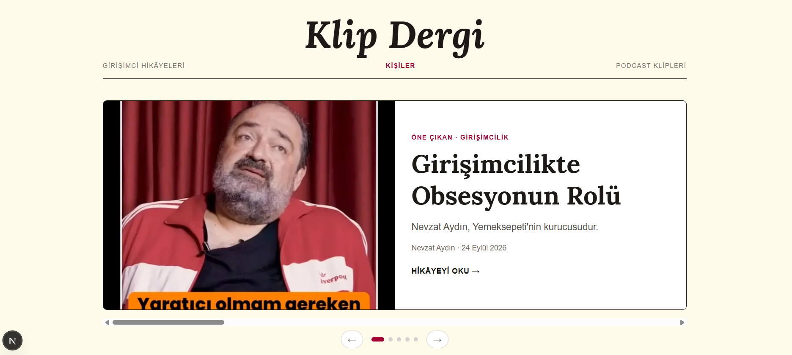
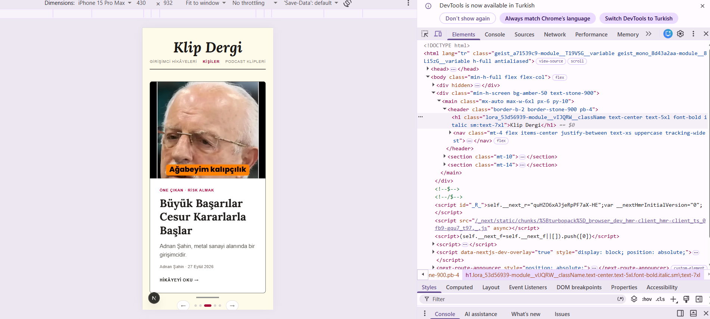

# Gün 11 · Perşembe (5 Kasım) planı · çalıştığım gün: 7 Kasım

Dal: `hafta3`

## Planın istediği

- Ana sayfada tek "öne çıkan" yerine 4-5 hikâyelik bir **vitrin**.
- **Adım 1 (yalnız CSS):** Yatay kayan şerit. `flex overflow-x-auto snap-x snap-mandatory`, her kartta `snap-start`. Telefonda parmakla kayar. JavaScript yok.
- **Adım 2 (state):** Sağ/sol oklar ve altta noktalar. Hangi hikâyede olduğunu `useState` ile tut, birkaç saniyede bir kendiliğinden kayma için `useEffect`. Bu bileşen `"use client"` ister. İlk kez state yazacaksın.
- Adım 2 bitmezse Adım 1 yeter.
- **Çıktı:** Kayan vitrin, telefonda ve masaüstünde.

Kaynaklar: [Tailwind scroll-snap](https://tailwindcss.com/docs/scroll-snap-type), [React: State](https://react.dev/learn/state-a-components-memory), [useEffect](https://react.dev/learn/synchronizing-with-effects), [Next.js use client](https://nextjs.org/docs/app/api-reference/directives/use-client)

## Bugün ne yaptım

- Öne çıkan bölümü **5 hikâyelik kayan vitrine** çevirdim (Adım 1, sadece CSS).
- Vitrini ayrı bir bileşene taşıdım: `src/components/Vitrin.tsx`, en üstte `"use client"`.
- **İlk state'imi yazdım:** `useState` ile "kaçıncı hikâyedeyiz", oklar ve noktalar.
- `useEffect` ve `setInterval` ile her 5 saniyede bir **kendiliğinden kayma**.
- Telefonda (iPhone SE görünümü) ve masaüstünde test ettim, ekran görüntülerini aldım.
- **Adım 1 ve Adım 2'nin ikisi de bitti.**

## Ekran görüntüleri

| Masaüstü | Telefon |
|---|---|
|  |  |

Perşembe için hocam ekran görüntüsü istememiş ("telefonda ve masaüstünde" = iki ekranda da çalışsın). Cuma'daki "önce/sonra görselleriyle" PR'a hazırlık olsun diye aldım.

## Adım 1: Kayan şerit (yalnız CSS)

### Fikir

5 hikâye yan yana dizili, ama ekranda aynı anda sadece **biri** görünüyor. Kalanlar sağda, ekranın dışında bekliyor. Kaydırınca sıradaki geliyor.

```
          ekran
        ┌───────┐
        │Hikâye │ Hikâye  Hikâye  Hikâye  Hikâye
        │   1   │   2       3       4       5
        └───────┘
         ← parmakla kaydır →
```

### Sınıflar

| Sınıf | Okunuşu | Ne yapıyor |
|---|---|---|
| `flex` | fleks | Hikâyeleri yan yana diz |
| `overflow-x-auto` | o-vır-flo eks | Yatayda taşanı gizleme, kaydırma çubuğu ver |
| `snap-x` | snep eks | Yatay kaydırmada "yerine oturma"yı aç |
| `snap-mandatory` | snep men-dı-tı-ri | Oturma zorunlu: yarıda bırakırsan bile en yakın hikâyeye otursun |
| `snap-start` | snep start | Her hikâyede: sol kenarım şeridin sol kenarına otursun |
| `w-full` | | Her hikâye şeridin tam genişliği kadar (ekranda tek hikâye) |
| `shrink-0` | şrink | **Küçülme!** `flex` sığdırmak için daraltır, 5 hikâye ezilirdi |
| `gap-4` / `pb-4` | | Hikâyeler arası boşluk / kaydırma çubuğu kutuya yapışmasın |

**Snap** = çıt diye yerine oturmak. Instagram hikâyelerini kaydırırken yarıda kalmaması gibi.

### Vitrin ve diğerleri: slice

Karar: Vitrindekiler "Diğer hikâyeler"de **tekrar etmesin** (dergi kapağındaki haber içeride tekrar çıkmaz, tam liste için Kişiler sayfası var).

```tsx
const vitrin = kisiler.slice(0, 5); // 0, 1, 2, 3, 4 → 5 kişi
const digerleri = kisiler.slice(5); // 5'ten sona → 7 kişi
```

`slice(başla, bitir)`: **bitir dahil değil.** "5. durağa kadar git" = 5'te inmezsin. İlk sayının bittiği yerde ikincisi başlıyor.

İlk cevaplarım `slice(0, 12)` (hepsi) ve `slice(12)` (boş liste), sonra `slice(0, 4)` (4 kişi) idi. Sıra tablosuyla buldum:

| Sıra | 0 | 1 | 2 | 3 | 4 | 5 | 6 | 7 | 8 | 9 | 10 | 11 |
|---|---|---|---|---|---|---|---|---|---|---|---|---|
| Kişi | Nevzat | Hamdi | Adnan | Mustafa | Ata | Acun | Elon | Aykut | Efe | Mehmet | Abdullah | Mark |
| Yer | vitrin | vitrin | vitrin | vitrin | vitrin | diğer | diğer | diğer | diğer | diğer | diğer | diğer |

### TypeScript bu sefer gösterdi

`oneCikan` ve `oneCikanKlip`'i silince 8 hata çıktı: **"Cannot find name 'oneCikan'."** Hepsi öne çıkan bölümün satırlarındaydı. TypeScript değiştirmem gereken yerleri kendisi gösterdi (Salı `as` yüzünden göstermemişti).

### map'in ikinci bilgisi ve LCP

```tsx
vitrin.map((kisi, sira) => ...)        // sira: 0, 1, 2...
loading={sira === 0 ? "eager" : "lazy"} // sadece ilk hikâye hemen yüklensin
```

Çarşamba'daki LCP dersinin devamı: İlk ekranda sadece ilk hikâye görünüyor.

## Adım 2a: Sunucu mu, istemci mi?

"Hangi hikâyedeyiz" bilgisini **tarayıcı** tutmalı. Restoran: Müşteri tuz isteyince mutfağa sipariş verilmez, masadaki tuzluk kullanılır.

| | Sunucu bileşeni | İstemci bileşeni |
|---|---|---|
| Nerede çalışır | Sunucuda, bir kere | Ziyaretçinin tarayıcısında |
| Restoranda | Mutfak | Masa |
| Tıklamayı duyar mı? | ❌ | ✅ |
| `useState` / `useEffect` | ❌ | ✅ |
| Nasıl | Normal | En üstte `"use client";` |

- **İstemci** = client (klay-ınt) = hizmet isteyen taraf (tarayıcı). **Sunucu** = server (sör-vır) = hizmet veren (Vercel).
- `"use client"` = "Bu dosya istemcide de çalışsın."
- **Sadece vitrini** client yaptım, sayfanın geri kalanı sunucuda kaldı (masaya sadece tuzluk, bütün mutfak değil).
- Vitrin sayfadan iki şey kullanıyordu: `tarihYaz` ve `baslikFontu`. Taşınırken ikisini de yanına aldı. Sayfada `baslikFontu` kaldı (logo ve "Diğer hikâyeler" için), `tarihYaz` ve `Image` import'u gitti.
- Sayfada artık tek satır: `<Vitrin kisiler={vitrin} />`. `Person[]` = Person **listesi**.
- `npm run build`'de `/` hâlâ ○ (statik). Sayfa sunucuda hazırlanıyor, vitrin tarayıcıda canlanıyor.

## Adım 2b: useState, oklar ve noktalar

### State nedir?

React kaynağının başlığı: *"State: A Component's Memory"*, yani **bileşenin hafızası**. Şimdiye kadarki bileşenler hafızasızdı. Vitrin ise "kaçıncı hikâyedeyiz?" sorusunu hatırlamalı.

**Benzetme: kitap ayracı.** Kitap aynı, ayraç hangi sayfada olduğunu hatırlıyor.

```tsx
const [aktif, setAktif] = useState(0);
```

| Parça | Anlamı |
|---|---|
| `useState(0)` | Hafıza kutusu aç, başta içinde 0 olsun (ilk hikâye) |
| `aktif` | Kutudaki değer |
| `setAktif` | Değeri değiştiren fonksiyon (set = ayarla) |

**Kural:** `aktif = 3` yazılmaz. `setAktif(3)` hem değeri değiştirir hem React'e "ekranı yeniden çiz" der. Ayracı oynatınca kitap da o sayfaya açılır.

### Başa dönmek: % (mod)

Son hikâyede sağ ok: **başa dönsün** (benim kararım; otomatik kayma için de şart, yoksa vitrin donar).

**Benzetme: saat.** 12'den sonra 13 değil 1 gelir.

```
(aktif + 1) % 5        2 → 3     4 → 0 (başa)
(aktif - 1 + 5) % 5    0 → 4 (sona)   (+5: eksi sayı olmasın)
```

Kodda 5 yerine `kisiler.length`. Vitrine 4 ya da 6 kişi koysam da çalışır.

### useRef

Ok'a basınca şeridin gerçekten kayması lazım. **`useRef`** (yuz-ref) = ekrandaki bir kutuyu elde tutmak.

| | Ne tutar | Değişince ekran çizilir mi? |
|---|---|---|
| `useState` | Bir değer | Evet |
| `useRef` | Ekrandaki bir kutu | Hayır |

```tsx
const seritRef = useRef<HTMLDivElement>(null);
<div ref={seritRef} onScroll={kaydirinca} className="relative flex ...">
serit.scrollTo({ left: hedef.offsetLeft, behavior: "smooth" });
```

- `scrollTo` = şu konuma kay · `smooth` = yumuşakça · `offsetLeft` = hedefin şeridin solundan uzaklığı (şeride `relative` bu yüzden).
- `onScroll` = kaydırılınca: `Math.round(scrollLeft / clientWidth)` ile kaçıncı hikâyede olduğumuzu hesaplayıp `setAktif`. Elle kaydırınca noktalar da takip ediyor.

### Oklar ve noktalar

| Parça | Ne yapıyor |
|---|---|
| `onClick={() => git(aktif + 1)}` | Tıklanınca (on-klik) sıradakine git |
| `button type="button"` | Düğme; form içinde olsa bile formu göndermesin |
| `aria-label="Sonraki hikâye"` | Ekran okuyucu için açıklama (← tek başına anlam vermez). Cuma Lighthouse Accessibility. |
| `sira === aktif ? "w-6 bg-rose-800" : "w-2 bg-stone-300"` | Aktif nokta bordo ve uzun, diğerleri gri ve yuvarlak |
| `transition-all` | Genişlik ve renk yumuşakça değişsin |

## Adım 2c: useEffect, kendiliğinden kayma

Şimdiye kadar her şey bir olaya bağlıydı (`onClick`, `onScroll`). Burada kimse bir şey yapmıyor, sadece **zaman geçiyor**. Benim cevabım: **alarm** ⏰

- **`setInterval`** (set-in-tır-vıl) = tekrarlayan alarm. `5000` ms = 5 saniye.
- **`clearInterval`** = alarmı kapat.
- **`useEffect`** (yuz-i-fekt) = bileşen ekrandayken şunu yap, giderken şunu topla.

```tsx
useEffect(() => {
  const zamanlayici = setInterval(() => {
    const yeni = (aktif + 1) % kisiler.length;
    seridiKaydir(seritRef.current, yeni);
    setAktif(yeni);
  }, KAYMA_SURESI);
  return () => clearInterval(zamanlayici);
}, [aktif, kisiler.length]);
```

| Parça | Benzetme |
|---|---|
| İçindeki kod | Yatarken alarmı kurmak |
| `return () => clearInterval(...)` | Kalkınca alarmı kapatmak (kapatmazsan ertesi gün iki alarm çalar) |
| `[aktif, kisiler.length]` | aktif değişince eski alarmı kapat, yenisini kur |

**Yan etkisi:** Oka basınca `aktif` değişiyor, alarm baştan kuruluyor. Vitrin hemen kaymıyor, 5 saniye bekliyor.

Kaydırma kodunu `seridiKaydir` adında bileşenin **dışına** aldım. Hem oklar (`git`) hem alarm kullanıyor, iki kere yazmadım (kurabiye kalıbı). `KAYMA_SURESI = 5000` sabiti de en üstte.

## Vitrin.tsx'in yapısı

```
"use client"
import useEffect, useRef, useState (react) · Link · Image · Lora · Person
baslikFontu · KAYMA_SURESI · tarihYaz · seridiKaydir
Vitrin({ kisiler })
  ├─ const [aktif, setAktif] = useState(0)
  ├─ const seritRef = useRef(null)
  ├─ useEffect → setInterval / clearInterval
  ├─ git(sira) → seridiKaydir + setAktif
  ├─ kaydirinca() → setAktif(Math.round(...))
  └─ return
      ├─ şerit (ref, onScroll, snap) → kisiler.map → hikâye kutusu (Link)
      └─ alt satır: ← · noktalar (kisiler.map) · →
```

## Nerede takıldım

- `slice`'ın ikinci sayısının dahil olmadığını sıra tablosuyla anladım.
- "Vitrin sayfadan hangi iki şeyi kullanıyor?" sorusunu bilemedim (`tarihYaz`, `baslikFontu`).
- "İstemci" kelimesini bilmiyordum: client'ın Türkçesi.
- Hangi `page.tsx`'te olduğumu yine karıştırdım. Ana sayfa = `src › app › page.tsx`, fonksiyon `Home`.


## Kelimeler

| Kelime | Okunuşu | Anlamı |
|---|---|---|
| carousel / vitrin | ke-rı-sel | Kayan hikâye şeridi |
| overflow-x | o-vır-flo eks | Yatay taşma |
| snap | snep | Yerine oturma |
| mandatory | men-dı-tı-ri | Zorunlu |
| shrink | şrink | Küçülmek |
| slice | slays | Dilim |
| state | steyt | Durum, bileşenin hafızası |
| useState | yuz-steyt | Hafıza kutusu aç |
| useRef / ref | yuz-ref | Ekrandaki bir kutuyu elde tutmak |
| useEffect / effect | yuz-i-fekt | Ekrandayken yan iş, giderken temizlik |
| setInterval | set-in-tır-vıl | Tekrarlayan alarm |
| clearInterval | klir-in-tır-vıl | Alarmı kapat |
| client / istemci | klay-ınt | Hizmet isteyen taraf (tarayıcı) |
| server / sunucu | sör-vır | Hizmet veren taraf |
| onClick | on-klik | Tıklanınca |
| onScroll | on-skrol | Kaydırılınca |
| scrollTo | skrol-tu | Şu konuma kay |
| smooth | smuuz | Yumuşak |
| % (mod) | mod | Bölmeden kalan |
| aria-label | er-ya leybıl | Ekran okuyucu açıklaması |
| hydrate | hay-dreyt | Sunucunun gönderdiği sayfanın tarayıcıda canlanması |

## Commit'lerim

1. `Öne çıkan bölümü kayan vitrine çevir` (Adım 1)
2. `Vitrini ayrı bir istemci bileşenine taşı` (Adım 2a)
3. `Vitrine oklar ve noktalar ekle` (Adım 2b, ilk state)
4. `Vitrine kendiliğinden kayma ekle` (Adım 2c)
5. `Perşembe için ekran görüntülerini ekle`
6. `gün 11 notunu ekle 5 kasım`


