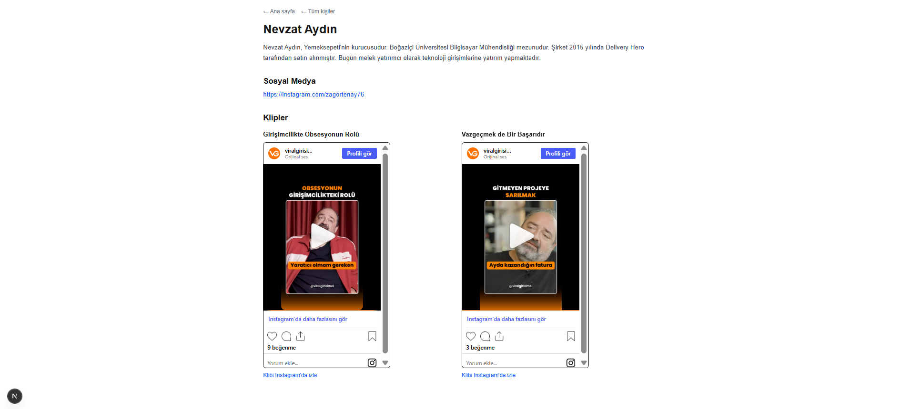
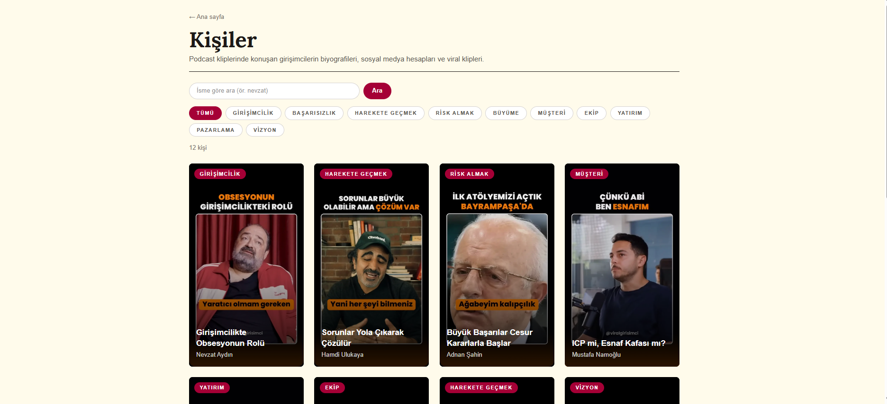

# Gün 12 · Cuma (6 Kasım) planı · çalıştığım gün: 7 Kasım

Dal: `hafta3`

**PR linki:** https://github.com/symkllci/klip-dergi/pull/3

## Planın istediği

- Kişi sayfası ana sayfayla aynı temada: üstte büyük kapak ve isim, biyografi giriş paragrafı gibi (büyük, rahat satır aralığı), klipler yatay şeritte, en altta "Diğer kişiler" kartları (3 kişi).
- Telefonda (375 px) bütün sayfaları kontrol et. Koyu modda da bir kez aç.
- Lighthouse: Performance, Accessibility, SEO puanlarını notuna yaz. 90'ın altını sebebiyle not et.
- Akşam: hafta3 → main PR'ını aç, açıklamaya önce/sonra ekran görüntülerini koy.
- **Çıktı:** PR linki.

## Bugün ne yaptım

- Kişi sayfasının "önce" ekran görüntüsünü aldım.
- **Kişi sayfasını yeni tasarıma çevirdim** (`src/app/kisiler/[slug]/page.tsx`): krem tema, büyük kapak ve Lora isim, konu etiketleri, sosyal medya düğmeleri, giriş paragrafı gibi bio, yatay klip şeridi, altta 3 kişilik "Diğer kişiler".
- 375 px'te bütün sayfaları kontrol ettim, ana sayfada iki sorunu düzelttim.
- Koyu modda açtım, sayfalar okunuyor.
- Lighthouse ile üç sayfayı ölçtüm, hepsi 90'ın üstünde.
- hafta3 → main **PR #3**'ü önce/sonra görüntüleri ve Lighthouse tablosuyla açtım.

## Kişi sayfası

Önce/sonra:  

### Dört parça

```
← Ana sayfa   ← Tüm kişiler
┌──────────┐
│  BÜYÜK   │   EKİP · RİSK ALMAK      ← 1. Üst: kapak + etiketler + isim + sosyal medya
│  KAPAK   │   Acun Ilıcalı
│  (9:16)  │   [instagram.com/...]
└──────────┘
━━━━━━━━━━━━━━━━━━━━━━━━━━━━━━━━━━━━
Acun Ilıcalı, medya ve televizyon...    ← 2. Bio: büyük, rahat satır aralığı
Klipler ───────────────────────────     ← 3. Klipler: yatay kayan şerit
Diğer kişiler ─────────────────────     ← 4. Altta 3 KlipKarti
```

İlk anlatım çok karışık geldi, 4 parçaya bölerek tek tek yaptık.

### 1. Üst kısım

| Parça | Kod | Neden |
|---|---|---|
| Düzen | `grid md:grid-cols-[minmax(0,18rem)_1fr]` | Orta ekranda solda 18rem kapak, sağda kalan alan. Telefonda alt alta. |
| Alt çizgi | `border-b-2 border-stone-900` | Ana sayfadaki logonun altındaki kalın çizgi gibi |
| Kapak kutusu | `relative aspect-[9/16] max-w-xs mx-auto md:mx-0` | 9:16, telefonda ortada ve dar |
| Kapak resmi | `Image fill object-cover loading="eager"` | İlk ekrandaki en büyük resim (LCP) |
| `sizes` | `(min-width: 768px) 18rem, 20rem` | Kutunun genişliği kadar resim indirilsin |
| İsim | Lora, `text-5xl sm:text-6xl` | Dergi başlığı gibi |

**Konu etiketleri (tekrarsız):**

```tsx
const konular = [...new Set(kisi.clips.map((klip) => klip.topic))];
```

- `map` → kliplerin konuları: `["ekip", "risk almak"]` (Hamdi'de `["harekete geçmek", "harekete geçmek"]`)
- `new Set(...)` → **Set** = aynı olanları bir kere tutan kutu → Hamdi'de tek "harekete geçmek"
- `[...]` → Set'i tekrar listeye çevir (map kullanabilmek için)

**Sosyal medya, sadece linki varsa:**

```tsx
{kisi.links.length > 0 && ( ... )}
```

`&&` = "soldaki doğruysa sağdakini göster". Adnan ve Abdullah'ın linki yok, bölüm hiç görünmüyor. **1. haftadan beri sormak istediğim "Adnan'ın boş Sosyal Medya başlığı" sorunu böyle çözüldü.**

Düğmede `link.replace("https://", "").replace("www.", "")` ile adres sadeleşiyor: `instagram.com/acunilicali/`.

### 2. Bio

```tsx
<p className="mt-8 max-w-3xl text-xl leading-loose text-stone-700 sm:text-2xl sm:leading-loose">
```

| Sınıf | Neden |
|---|---|
| `text-xl sm:text-2xl` | Büyük yazı, giriş paragrafı gibi |
| `leading-loose` | Çok rahat satır aralığı (lidıng = satır arası) |
| `max-w-3xl` | Satır çok uzamasın; çok uzun satırı göz takip edemez |

### 3. Klipler: yatay şerit

Perşembe'deki vitrinle aynı sınıflar: `flex snap-x snap-mandatory gap-6 overflow-x-auto pb-4`, her klipte `shrink-0 snap-start`.

**Tek fark:** Vitrinde her hikâye `w-full` (ekranın tamamı), burada her klip **`w-[320px]`** (reel genişliği). Büyük ekranda birkaç klip yan yana görünüyor, sığmayan sağda bekliyor. Her klibin üstünde bordo konu satırı var.

### 4. Diğer kişiler

Seçenekler:
- **A)** İlk 3 kişi: Nevzat'ın sayfasında kendisi de çıkar, her sayfada hep aynı 3 kişi.
- **B)** Kişiden **sonra gelen 3 kişi** ✅
- **C)** Aynı konudaki kişiler: Bazı konularda 3 kişi yok (pazarlama: sadece Ata).

```tsx
const tumKisiler = getAllPeople();
const sira = tumKisiler.findIndex((k) => k.slug === kisi.slug);
const digerKisiler = [1, 2, 3].map((n) => tumKisiler[(sira + n) % tumKisiler.length]);
```

| Parça | Anlamı |
|---|---|
| `findIndex` (faynd-in-deks) | `find`'ın kardeşi: kişinin kendisini değil **sırasını** verir |
| `[1, 2, 3].map(...)` | 1, 2 ve 3 sonraki kişiyi al |
| `% tumKisiler.length` | Perşembe'deki saat: liste bitince başa dön |

| Sayfa | sira | Diğer kişiler |
|---|---|---|
| Nevzat | 0 | 1, 2, 3 → Hamdi, Adnan, Mustafa |
| Mark | 11 | 12 % 12 = 0, 1, 2 → Nevzat, Hamdi, Adnan |

Kartlar ana sayfadaki `KlipKarti`. Bu hafta yazdığımız kalıp üçüncü sayfada da kullanılıyor.

### Bu sayfada birleşenler

| Bu haftadan | Kişi sayfasında |
|---|---|
| Pazartesi: `find` | `getPersonBySlug` + yeni kardeşi `findIndex` |
| Salı: `cover` | Büyük kapak |
| Çarşamba: tema, `next/image`, `KlipKarti` | Krem zemin, Lora, kapak, "Diğer kişiler" kartları |
| Perşembe: `snap-x`, `%` | Klip şeridi, başa dönen "Diğer kişiler" |

## 375 px kontrolü

F12 → telefon simgesi → **iPhone SE** (375 px). iPhone SE zorunlu değil, önemli olan genişliğin 375 olması (başka telefon ya da **Responsive** + 375).

Bakılanlar: Sayfanın **tamamı** sağa taşıyor mu (şeritlerin kayması normal), yapışık ya da üst üste yazı var mı?

| Sayfa | Sonuç |
|---|---|
| Ana sayfa | 2 sorun, düzeltildi |
| Kişiler | Tamam ✅ |
| Kişi | Tamam ✅ |

**Ana sayfadaki sorunlar:**

1. **Menüde "KİŞİLER" ile "PODCAST KLİPLERİ" yapışıktı.** Masaüstünde ekran geniş olduğu için fark edilmiyordu. → `<nav>`'a **`gap-4`** (en az bu kadar boşluk).
2. **Vitrinde resmin altında boş beyaz alan vardı.** `flex` bütün hikâyeleri **en uzununun boyuna** çeker. Telefonda yazılar alt alta geldiği için uzun olan hepsini uzatıyordu. → Şeride **`items-start`** (herkes kendi boyunda).

Sol alttaki siyah "N" yuvarlağı `npm run dev`'in geliştirme simgesi, Vercel'de görünmüyor.

## Koyu mod

Windows + I → Kişiselleştirme → Renkler → **Koyu**. Üç sayfa da krem zemin ve koyu yazıyla okunuyor ✅ Pazartesi `globals.css`'teki `@media (prefers-color-scheme: dark)` bloğunu silmenin sonucu.

## Lighthouse

**Lighthouse** (layt-haus = deniz feneri): Chrome'un içinde gelen ölçüm aracı, 0–100 arası puan veriyor. **Karne** gibi: 4 ders, her biri 100 üzerinden.

| Ders | Ne soruyor? | Restoran benzetmesi |
|---|---|---|
| Performance | Sayfa ne kadar hızlı açılıyor? | Yemek ne çabuk geldi? |
| Accessibility | Herkes (ekran okuyucu, klavye) kullanabiliyor mu? | Rampa ve büyük puntolu menü var mı? |
| Best Practices | Doğru ve güvenli yazılmış mı? | Mutfak temiz ve kurallara uygun mu? |
| SEO | Google sayfayı anlıyor mu? | Haritalarda ve rehberlerde doğru görünüyor mu? |

🟢 90–100 iyi · 🟠 50–89 geliştirilmeli · 🔴 0–49 kötü

### Nasıl ölçtüm?

1. `npm run dev` ile **ölçülmez** (geliştirme modu yavaş, puanı düşük gösterir). → `npm run build`, sonra `npm start` (build edilmiş site, Vercel gibi hızlı).
2. **Gizli pencere** (Ctrl + Shift + N): Eklentiler ölçümü bozmasın.
3. F12 → üst sekmeler → **»** → **Lighthouse**.
4. Mode: Navigation · Device: **Mobile** · Categories işaretli → **Analyze page load** → 20–30 saniye dokunma.
5. Yeni sayfa için sol üstte **+** (New report).

### Sonuçlar (Mobile)

| Sayfa | Performance | Accessibility | Best Practices | SEO |
|---|---|---|---|---|
| Ana sayfa | **91** | **96** | **100** | **100** |
| Kişiler | **94** | **98** | **100** | **100** |
| Kişi (Acun) | **93** | **100** | **100** | **100** |

**90'ın altında puan yok**, sebep yazmaya gerek kalmadı.

Ekran görüntüleri: `gun12-lighthouse-ana.png`, `gun12-lighthouse-kisiler.png`, `gun12-lighthouse-acun-kisi..png`

### Bu haftanın puana etkisi

- **Performance:** `next/image` + `sizes`, ilk ekrandaki resimlerde `loading="eager"` (LCP), diğerleri `lazy`.
- **Accessibility:** Resimlerde `alt`, oklarda ve noktalarda `aria-label`, `lang="tr"`.
- **SEO:** Sayfa başlıkları ve açıklamalar (`metadata`), `lang="tr"`.

Çarşamba kişiler sayfasında LCP uyarısı almıştık. Tahminim düşük çıkacağıydı, ama kişiler sayfası **94** aldı. Uyarı bir öneriydi, puanı çok etkilemedi.

Konsoldaki "Permissions-Policy header" ve "preloaded but not used" yazıları Instagram'ın gömme penceresinden ve tarayıcıdan geliyor, bizim kodumuzdan değil.

## PR

**https://github.com/symkllci/klip-dergi/pull/3**

**Adımlar:**
1. github.com/symkllci/klip-dergi → sarı şeritte **Compare & pull request** (ya da Pull requests → New pull request)
2. **base: main ← compare: hafta3** (kahve fincanı ← süt)
3. Başlık: *3. hafta: 12 kişi, kapak kartları, kayan vitrin ve yeni kişi sayfası*
4. Açıklama: günlerin özeti, önce/sonra tablosu, telefon görüntüsü, Lighthouse tablosu, notlar ve sorum
5. **Preview** ile resimlere baktım → **Create pull request**
6. **Merge'e basmadım**, birleştirme hocamın işi.

Resimleri sürükle-bırak yerine şu adresle koydum (repo public olduğu için çalışıyor):

```
https://raw.githubusercontent.com/symkllci/klip-dergi/hafta3/notlar/DOSYA.png
```


## Kelimeler

| Kelime | Okunuşu | Anlamı |
|---|---|---|
| Set | set | Aynı olanları bir kere tutan kutu |
| `...` (spread) | spred | Kutunun içini dök (Set'i listeye çevirmek) |
| `&&` | ve | Soldaki doğruysa sağdakini göster |
| findIndex | faynd-in-deks | Uyanın sırasını ver |
| leading | lidıng | Satır aralığı |
| responsive | ris-pon-siv | Ekran boyuna uyan |
| Lighthouse | layt-haus | Chrome'un ölçüm aracı (deniz feneri) |
| Performance | pır-for-mıns | Hız puanı |
| Accessibility | ık-se-sı-bi-li-ti | Erişilebilirlik |
| Best Practices | best prek-tı-sız | En iyi uygulamalar |
| SEO | es-i-o | Arama motoru uyumu |
| incognito / gizli pencere | in-kog-ni-to | Eklentisiz, geçmişsiz pencere |
| npm start | | Build edilmiş siteyi çalıştır |
| Added (A) | ed-did | Git'e eklendi |
| Pull Request (PR) | pul ri-kuest | "Dalımı ana dala al" isteği |
| base / compare | beyz / kım-per | Gireceği dal / geldiği dal |
| merge | mörc | Birleştirmek (hocanın işi) |
| conflict | kon-flikt | Çakışma |

## Commit'lerim

1. `Cuma için kişi sayfası önce ekran görüntüsünü ekle`
2. `Kişi sayfasına kapak, isim ve bio bölümü ekle`
3. `Kişi sayfasında klipleri yatay şeride çevir`
4. `Kişi sayfasını yeni tasarıma çevir` (Diğer kişiler)
5. `Telefonda menü aralığını ve vitrin boşluğunu düzelt`
6. `Lighthouse ekran görüntülerini ekle`
7. `Kişi sayfası sonra ekran görüntüsünü ekle`
8. `gun12.md eklendi`
