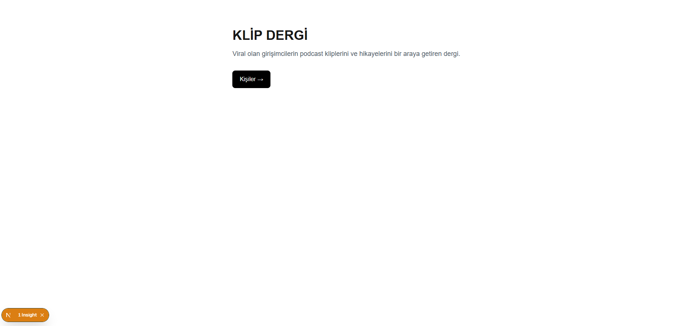
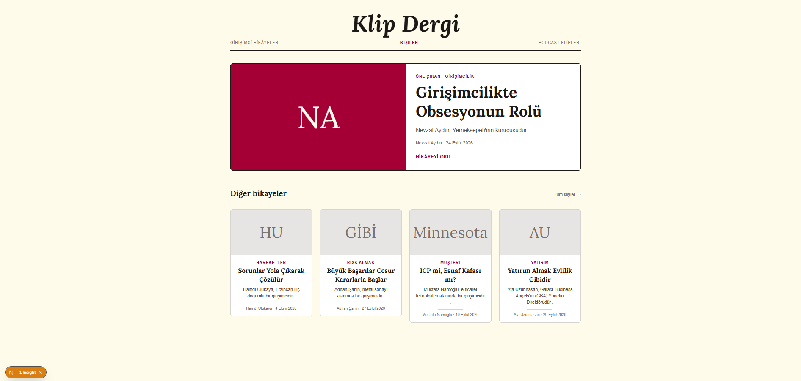

## Ne yaptım
- **Ana sayfayı baştan tasarladım.** Önceden sadece başlık, bir cümle ve "Kişiler" düğmesi vardı. Şimdi dergi kapağı gibi:
  - En üstte ortalanmış, büyük, italik **"Klip Dergi"** logosu ve altında ince menü satırı
  - **Öne çıkan kişi:** büyük baş harf kutusu, konu etiketi, hikâye anlatan başlık (ilk klibin başlığı), bir cümlelik alt başlık, kişi · tarih satırı, "Hikâyeyi oku →"
  - Altında **"Diğer hikâyeler":** diğer 4 kişinin kartları
- **Renk paletimi seçtim:** krem zemin (amber-50), koyu mürekkep (stone-900), bordo vurgu (rose-800).
- **Başlık fontu:** Google Fonts'tan Lora (serif). Logo italik, başlıklar düz, metinler sade.
- **Fotoğraf kullanmadım** (telif). Yerine kişinin baş harflerinden bir kutu koydum ("NA").
- **Perşembe'nin işinden konu filtresini bugün yaptım:**
  - /kisiler sayfasının üstüne konu düğmeleri koydum: "Tümü" + kliplerden çıkan her konu.
  - Konular kliplerin `topic` alanından otomatik çıkıyor, npm run dev
  - Bir konuya tıklayınca sadece o konuda klibi olan kişiler kalıyor.
  - Seçilen konu adreste duruyor (`/kisiler?konu=yatırım`). Sayfa yenilense de, adres başka sekmede açılsa da aynı sonuç geliyor.
  - "Tümü" filtreyi kaldırıyor.
  - Arama kutusunu (Perşembe'nin üçüncü maddesi) yarın yapacağım.
- **README'yi güncelledim:** özellikler, tasarım ve konu filtresi eklendi.

## Önce / sonra
- Önce: 
- Sonra: 

## Kaynaklardan ne aldım
| Kaynak | Ne gördüm | Ne aldım |
|---|---|---|
| Colossus | Dev serif logo, ince menü satırı, gri görsellerin üstüne gelince renklenmesi, kartta başlık + alt yazı + çizgi + yazar | Ortalanmış logo, menü satırı, gri kutunun bordoya dönmesi, kart düzeni |
| girisimler.net | Başlığın üstünde kategori etiketi, altında "yazar – tarih" satırı | Kartlarda konu etiketi (`topic`) ve "kişi · tarih" satırı (`publishedAt`) |
| Next.js Fonts | Font `next/font/google`'dan getiriliyor, `className` ile veriliyor, sadece kullanıldığı yerde geçerli | Lora'yı sadece başlıklarda kullandım |
| Next.js searchParams | `searchParams` sayfaya Promise olarak geliyor, `await` ile açılıyor | Konu filtresinde `?konu=` bilgisini böyle okudum |
| MDN filter | `filter` şarta uyan **bütün** elemanları yeni bir liste olarak verir | Seçili konudaki kişileri süzmek için kullandım |

Colossus'u kopyalamamak için: logoyu kalın ve sıkışık değil italik yaptım (önce Playfair Display'in en kalın halini denedim, çok benzediği için Lora'ya geçtim), siyah-beyaz yerine kendi renklerimi seçtim.

## Öğrendiklerim

### Ana sayfa
- **Bileşen yazmak:** `HikayeKarti` benim ilk kendi bileşenim. Kartı bir kez tarif ettim, `<HikayeKarti kisi={kisi} />` ile 4 kez kullandım. `{ kisi }: { kisi: Person }` = bu bileşene bir kişi verilir (props). 🔁 **Tekrar bak**
- **`kisiler[0]`:** listenin ilk elemanı. **`kisiler.slice(1)`:** ilk eleman hariç geri kalanlar.  **Tekrar bak**
- **Baş harfler:** `split(" ")` → `map((kelime) => kelime[0])` → `join("")`. "Nevzat Aydın" → "NA".  **Tekrar bak** (`join` yeni)
- **Tarih:** `new Date("2026-09-24").toLocaleDateString("tr-TR", { day, month: "long", year })` → "24 Eylül 2026".  **Tekrar bak**
- **`group` / `group-hover:`:** dış kutuya `group` yazınca, içindeki şeyler "kartın üstüne gelince" değişebiliyor.
- **`transition-colors`:** renk yumuşakça değişiyor.
- **Tailwind renkleri:** `stone`, `rose`, `amber` gibi adlar ve 50 (açık) ile 950 (koyu) arası tonlar. `bg-[#...]` köşeli parantezle kendi rengini yazmak için, ama hazır renkler yetti.
- **`next/font`:** `Lora({ subsets: ["latin", "latin-ext"], style: ["normal", "italic"] })`. `latin-ext` Türkçe harfler için gerekli.
- **`topic` ve `publishedAt`** alanlarını ilk kez ekranda kullandım.

### Konu filtresi
- **searchParams:** adresteki `?` sonrası bilgiler. `/kisiler?konu=yatırım` → `{ konu: "yatırım" }`. `params` gibi bir Promise, o yüzden sayfa `async` oldu ve `await searchParams` yazdım. 🔁**Tekrar bak**
- **params ile farkı:** `params` adresin kendisinden gelir (`/kisiler/nevzat-aydin` → slug). `searchParams` adresin `?` sonrasından gelir (`?konu=...`).
- **`typeof konu === "string"`:** konu bazen liste olabiliyor (`?konu=a&konu=b`). Sadece tek bir yazı ise kabul ediyorum.
- **Konu listesini çıkarmak:**  **Tekrar bak** (iç içe döngü)
  - `for (const kisi of tumKisiler)` → her kişiyi gez (map gibi, ama bir şey üretmiyor, sadece geziyor)
  - içinde `for (const klip of kisi.clips)` → o kişinin her klibini gez
  - `if (!konular.includes(klip.topic))` → bu konu listede **yoksa**
  - `konular.push(klip.topic)` → listeye ekle
  - Böylece "harekete geçmek" iki klipte olduğu halde bir kez çıkıyor.
- **`includes`:** "listede bu var mı?" Cevap true ya da false.
- **`push`:** listenin sonuna eleman ekle.
- **`filter`:** şarta uyan **bütün** elemanları getirir. `find` sadece **ilkini** getiriyordu.  **Tekrar bak** (find ile farkı)
- **`some`:** listedeki elemanlardan **en az biri** şarta uyuyor mu? Kişinin iki klibinden biri bile "yatırım" ise kişi listede kalıyor.  **Tekrar bak**
- **`koşul ? A : B`:** kısa if. "Seçili konu varsa süzülmüş liste, yoksa hepsi." Düğmelerde de kullandım: seçiliyse koyu, değilse çerçeveli.  **Tekrar bak**
- **`href={{ pathname: "/kisiler", query: { konu: k } }}`:** adresi nesne olarak verdim. Next.js "harekete geçmek" gibi boşluklu ve Türkçe harfli konuları adrese kendisi uygun yazıyor.
- **`flex-wrap`:** sığmayan düğmeler alt satıra geçiyor, telefonda taşmıyor.

## Tahmin ve sonuç
- **Tahmin:** Konu listesini çıkarınca "harekete geçmek" iki kez çıkar (Hamdi'nin iki klibi de bu konuda). **Sonuç:** `includes` kontrolü sayesinde bir kez çıktı.
- **Tahmin:** "yatırım"a tıklayınca sadece Ata Uzunhasan kalır. **Sonuç:** …
- **Tahmin:** Sayfayı yenileyince seçim kaybolur. **Sonuç:** Kaybolmadı, çünkü seçim adreste duruyor.

## Nerede takıldım, nasıl çözdüm
- İlk denemede logo Colossus'a çok benzedi. Fontu Playfair Display'den Lora'ya, kalınlığı `font-black`'ten italik `font-bold`'a çevirdim.

## JS boşluğu
- `slice`, `join` ve `new Date` yeni. `slice(1)` ile `slice(0, 1)` farkını Console'da denemem lazım.
- Bileşene props vermek: `{ kisi }: { kisi: Person }` yazımı karışık geliyor.
- İç içe `for` döngüsü: dıştaki her kişi için içteki bütün klipler dönüyor, bunu kafamda canlandırmam lazım.
- `filter`, `find` ve `some` farkı: üçü de şart soruyor ama farklı şey getiriyor. Console'da aynı listeyle üçünü denemem lazım.
- `koşul ? A : B` ile `if` farkı: ne zaman hangisi kullanılır?

